# Капри — живая

Капри, конструкт *Project Capricorn* из Cyberpunk: Edgerunners (2 сезон), живёт у тебя на рабочем столе. Она следит
за твоим ИИ для кода — **Claude Code**, **Codex** или **Antigravity** — телепортируется, глитчит, комментирует каждое
действие, прибегает, когда нужно твоё разрешение, и выходит из себя, когда работа сделана.

А ещё она **болтает с тобой** через любую нейросеть — **Claude**, Ollama на твоём ПК, Gemini, GPT, Groq и другие, —
злится, смеётся, обижается и смущается, говорит голосом, меняет цвет, видит твой экран, слышит тебя, двигается под твою
музыку, запоминает, кто ты, и живёт своей жизнью, пока ты занят.

> Это фанатский проект. Ответы пишет нейросеть, а не сценаристы сериала: это фанатская версия персонажа.
> Телега бездарного вайбкодера - https://t.me/pivoInsider
> Поддержите рублем или долларом или еще чем-нибудь(главное не бейте)-https://www.donationalerts.com/r/pivoinsider


## Что в ней есть (коротко)

- **Следит за твоим ИИ для кода** (Claude Code, Codex, Antigravity): комментирует каждое действие, зовёт, когда нужно
  твоё разрешение, и радуется (или злится), когда работа сделана.
- **Болтает с тобой** через любую нейросеть: Ollama на твоём ПК, Claude, Gemini, GPT, Groq и другие. Говорит голосом
  (Piper, Chatterbox, системным или облачным), видит экран, слышит тебя, танцует под твою музыку, запоминает, кто ты.
- **Живёт на рабочем столе:** сидит на твоих окнах и на панели задач и болтает ногами (качели, ленивое раскачивание,
  быстрые пинки, барабанит ногой, откидывается назад, смотрит вниз, мурлычет), парит и машет рукой, пожимает плечами,
  поправляет гриву, выглядывает из-за краёв экрана, падает, телепортируется, засыпает.
- **Вселяется в твои окна** и по-настоящему их двигает (8 способов: глюк, тряска, качка, танец, прогулка по экрану, шайба
  с отскоками, прыжки), а потом возвращает на место. Если ты берёшься за окно сам, она тут же отпускает.
- **Реагирует на мышку:** на клик по голове и по ногам, двойной клик, курсор, который подошёл, замер рядом или затрясся,
  на то, как её унесли и поставили. Пока к ней не подключена нейросеть, она сама об этом говорит, с кнопкой «Подключить».
- **Сама готовит всё нужное:** смотрит на твой ПК (процессор, память, видеокарта, диск), советует, какую модель Ollama
  и какой голос брать, и по одной кнопке находит или ставит Ollama, модель, Piper, Chatterbox и Node.js. Всё видно в
  [главном меню](#главное-меню-первый-запуск), которое открывается при первом запуске и в любой момент из кругового
  меню (вкладка **«Ещё»**).
- **Настраивает нейросети под дело и под твой ПК.** Для болтовни, для заметок о тебе и для взгляда на экран у модели разные
  настройки (температура, длина ответа, строгий JSON), они зависят от размера модели и от языка, а после установки она
  коротко проверяет, как модель на самом деле работает здесь, и подгоняется под результат.
  [Подробно](#настройка-нейросети-под-задачи-и-под-твой-пк).
- **Голос по образцу.** Chatterbox может говорить голосом короткой записи, которую ты ей дашь (5–30 секунд чистой речи);
  без записи она говорит собственным голосом модели, а Piper настроен на быструю живую речь. [Подробно](#голос).
- **Убирает за собой.** Раздел «Что стоит на компьютере» показывает, сколько места занимает всё скачанное, и удаляет
  ненужное (модели по одной или всё сразу). Деинсталлятор предлагает убрать заодно и скачанное: места освобождается
  столько, сколько она занимала. [Подробно](#удалить-ненужное-и-саму-капри).

## Оглавление

1. [Быстрый старт](#быстрый-старт)
2. [Установка и запуск на компьютере](#установка-и-запуск-на-компьютере)
3. [Как подключить нейросеть](#как-подключить-нейросеть)
4. [Как подключить слежение за Claude Code, Codex и Antigravity](#как-подключить-слежение-за-claude-code-codex-и-antigravity)
5. [Как ею пользоваться](#как-ею-пользоваться)
6. [Настройка](#настройка)
7. [Что она умеет](#что-она-умеет)
   - [Главное меню (первый запуск)](#главное-меню-первый-запуск) и [подбор по твоему ПК](#подбор-по-твоему-пк-ollama-chatterbox-и-piper-всё-готовится-само)
   - [Голос и голос по образцу](#голос)
   - [Настройка нейросети под задачи и под твой ПК](#настройка-нейросети-под-задачи-и-под-твой-пк)
   - [Удалить ненужное и саму Капри](#удалить-ненужное-и-саму-капри)
   - [Как она перемещается](#как-она-перемещается): сидит, вселяется в окна и двигает их, болтает ногами
8. [Демо без Claude](#демо-без-claude)
9. [Это безопасно](#это-безопасно)
10. [Что уходит с твоего компьютера](#что-уходит-с-твоего-компьютера)
11. [Если что-то не работает](#если-что-то-не-работает)
12. [Вопросы и ответы](#вопросы-и-ответы)
13. [Как она нарисована](#как-она-нарисована)
14. [Для разработчиков](#для-разработчиков)
15. [Авторы и права](#авторы-и-права)

---

## Быстрый старт

1. **Установи Капри** ([как](#установка-и-запуск-на-компьютере)): запусти установщик `Capri-Setup-….exe` (x64 или ia32) или сделай
   `npm install` и `npm start` из исходников.
2. **Выбери, на чём она думает и чем говорит**: при первом запуске сам открывается её **главное меню**. Там три шага:
   нейросеть (Ollama на твоём ПК или облачный сервис по ключу: Groq и Gemini бесплатные), голос (Piper, Chatterbox,
   системный или облачный) и кнопка **«Установить и запустить»**. Пока ты её не нажал, ничего не скачивается.
   Подробно — [ниже](#главное-меню-первый-запуск). Потом всё то же можно поменять в круговом меню (правый клик › вкладка
   **ИИ**) и в меню у часов › **«Главное меню»**. Про сами нейросети — [ниже](#как-подключить-нейросеть).
3. **Поговори**: правый клик › сектор **Говорить**.
4. *(Если пользуешься Claude Code, Codex или Antigravity)* нажми на её приветственной панели **«Подключить меня к Claude»**:
   она будет следить за твоим ИИ. Подробно — [ниже](#как-подключить-слежение-за-claude-code-codex-и-antigravity).

Остальное по желанию: голос, зрение, микрофон, перекраска, руки — всё включается в круговом меню (правый клик по ней).

---

## Установка и запуск на компьютере

Капри — приложение на Electron. Лучше всего она работает на **Windows 10/11**: только там она сидит на твоих окнах,
знает, что играет, видит окна, управляет ими и пишет в мессенджеры. На macOS и Linux она запускается из исходников
(прозрачному окну на Linux нужен композитор, лучше X11), но без этих функций. На macOS и Linux проект пока не
проверялся: она должна запускаться, летать, выглядывать из-за краёв экрана, падать и гулять.

На телефоне и Android она не работает: ей нужен рабочий стол.

### Вариант 1. Готовый установщик (Windows, без командной строки)

1. Скачай установщик под свою Windows (если в разделе **Releases** репозитория его нет, собери сам, вариант 2, шаг 5):
   - **`Capri-Setup-<версия>-x64.exe`** — для 64-битной Windows (почти у всех; проверить: Параметры › Система › О системе,
     «Тип системы»);
   - **`Capri-Setup-<версия>-ia32.exe`** — для 32-битной Windows. Он собран на Electron 43: более новые версии Electron
     32-битную Windows уже не поддерживают.
2. Установщик задаёт один вопрос: **в какую папку ставить** (по умолчанию `%LOCALAPPDATA%\Programs\Capri`, кнопка
   «Обзор…» выбирает любую другую, например на диске D:). Установка идёт **в твою учётную запись** (права администратора не
   нужны, поэтому не выбирай `C:\Program Files`), на рабочем столе появляется ярлык «Capri», и на последней странице стоит
   галочка «Запустить Capri». Язык установщика, русский или английский, выбирается по языку Windows. Node.js и ничего другого
   ставить не надо. Папка для **скачанного** (нейросети, голоса, Python-окружение) выбирается отдельно, уже в самой Капри:
   [Куда она всё скачивает](#куда-она-всё-скачивает). Тихая установка: `Capri-Setup-….exe /S /D=D:\Apps\Capri` (`/D=` всегда
   последний параметр, без кавычек).
3. Установщик не подписан (сертификат подписи платный), поэтому Windows SmartScreen может написать «Windows защитил ваш
   компьютер». Нажми **Подробнее**, затем **Выполнить в любом случае**. Предупреждение из-за отсутствия подписи, а не из-за
   того, что установщик что-то делает.
4. Она появится на экране и представится. Меню — **правый клик по ней**. То же меню есть на её иконке у часов, которую
   Windows 11 часто прячет за стрелкой **^**.

### Вариант 2. Из исходников (Windows, macOS, Linux)

1. Нужен [Node.js](https://nodejs.org) версии **18 или новее** (лучше 20+). **На Windows можно ничего не ставить:** двойной
   щелчок по **`start-capri.cmd`** в папке проекта сам проверит Node.js, а если его нет (или он старый), скачает переносную
   версию с nodejs.org в твою папку (`%LOCALAPPDATA%\Capri\node`, права администратора не нужны, файл проверяется по
   контрольной сумме nodejs.org), добавит её в PATH твоей учётной записи, поставит пакеты и запустит Капри (шаги 3 и 4 ниже
   он делает сам). Для скачивания проекта командой нужен ещё [Git](https://git-scm.com), но можно и без него (шаг 2).
2. Скачай проект. Либо на странице репозитория **Code › Download ZIP** и распакуй, либо в терминале:
   ```bash
   git clone https://github.com/untrainedDemonKing/capri-desktop-main.git
   cd capri-desktop-main
   git checkout capri-alive
   ```
   Ветка `capri-alive` — со всеми новыми возможностями (круговое меню, подключение Claude по ключу, саморазвитие и так
   далее). Если ты скачал ZIP, переключи ветку на странице репозитория до скачивания.
3. Установи зависимости (один раз, нужен интернет, скачивается Electron):
   ```bash
   npm install
   ```
4. Запусти:
   ```bash
   npm start
   ```
   Терминал нужно держать открытым, пока она работает (закроешь окно терминала — она исчезнет). Капри появится на
   рабочем столе, а её иконка — у часов.
5. **Установщик `.exe`** (по желанию): готовые файлы появятся в папке `dist/`.
   - `npm run dist` — 64-битный, `Capri-Setup-<версия>-x64.exe`;
   - `npm run dist:32` — 32-битный, `Capri-Setup-<версия>-ia32.exe` (на Electron 43, см. выше);
   - `npm run dist:all` — оба подряд.

   На Windows это работает сразу. На Linux для сборки нужен `wine` вместе с `wine32` (деинсталлятор NSIS запускается
   под ним), а на macOS — `wine`.

Проверить, что всё в порядке: `npm test` (все тесты должны пройти).

### Если установка или запуск не получились

| Что видишь | Что делать |
|---|---|
| `node` или `npm` «не является командой» | Node.js не установлен или не добавлен в PATH: запусти `start-capri.cmd` (он поставит его сам) или поставь с nodejs.org и открой **новый** терминал |
| `npm install` долго висит или падает на Electron | Проверь интернет, VPN и антивирус: Electron скачивает свой бинарник (около 100 МБ). Повтори `npm install` |
| «Port 47823 already in use» в терминале | Уже запущена другая Капри (или другая программа занимает порт). Закрой её через меню › **Выйти** и запусти снова. Порт можно сменить переменной окружения `CAPRI_PORT` |
| Фон за ней чёрный | Меню › **Отображение** › **OpenGL**, а если не помогло — **Без видеокарты** (подробнее [ниже](#если-что-то-не-работает)) |
| Windows не даёт запустить `.exe` | Нажми **Подробнее › Выполнить в любом случае** (SmartScreen) |

### После установки

- **Правый клик по Капри** — её круговое меню со всеми настройками. **Ctrl+Alt+C** — спрятать её или вернуть.
- **Автозапуск:** меню у часов › **Запускать вместе с Windows** (запись о запуске создаётся, только если ты поставил эту
  галочку).
- **Обновление:** из исходников — `git pull`, затем `npm install`. Установщик — просто запусти новый (он сам предложит папку, в которую
  Капри уже стоит). Твои
  настройки, память и «блокнот о тебе» лежат отдельно и сохранятся.
- **Где хранятся данные:** папка `Capri` в `%APPDATA%` (при запуске из исходников — `capri-desktop`). В ней:
  `config.json` (настройки; ключи там зашифрованы), `memory.json` (память чатов), `bond.json` (что она о тебе узнала),
  `installed.json` (что она сама скачала и поставила, чтобы суметь убрать это), папка `sounds` (твои звуки) и, если она
  что-то скачивала, папки `piper` (программа и голоса), `chatterbox` (Python-окружение и модель), `node` (портативный
  Node.js) и `ollama` (Ollama из zip). Их размер видно в [главном меню](#удалить-ненужное-и-саму-капри).
- **Удаление:** Параметры Windows › Приложения › Capri › Удалить. Установщик спросит, убрать ли заодно всё, что она
  скачала (нейросети, голоса, Python-окружение, Node.js, Ollama и Python, если их поставила она): «Да» освободит всё
  занятое ею место вместе с её настройками и памятью, «Нет» уберёт только программу. То же делает кнопка
  **«Удалить Капри целиком…»** в главном меню, а убрать лишнее и оставить её можно там же, по одному.
  Подробно — [ниже](#удалить-ненужное-и-саму-капри).

### Что изменится в системе

- Запись о хуках в `~/.claude/settings.json` (перед этим рядом создаётся копия, а твои хуки остаются), если ты нажал
  «Подключить меня». Убрать можно из её меню.
- Запись об автозапуске — только если поставил галочку «Запускать вместе с Windows».
- Всё, что она сама скачала и поставила (модели, голоса, Node.js, Ollama и Python, если их не было), записано в
  `installed.json` в её папке данных и убирается кнопками [главного меню](#удалить-ненужное-и-саму-капри).
- Node.js (портативный, в её папке данных) добавляется в PATH твоей учётной записи, и только если его не было; при
  удалении она убирает эту запись. Ollama и Python, если их не оказалось на ПК, ставятся обычным способом (`winget` или
  их установщик, без прав администратора) и записываются, чтобы их можно было убрать их же деинсталлятором.
- Окна других программ она двигает только когда «вселяется» в них и ты не выключил «Двигать окна, в которые вселилась»
  ([как это устроено](#как-она-перемещается)): сдвигается только положение, в конце окно возвращается на место.

---

## Как подключить нейросеть

Чтобы Капри отвечала в чате, ей нужен «мозг» — нейросеть. Подходит почти любая, выбирать и менять её можно в любой момент,
без перезапуска:

> **Правый клик по Капри › вкладка «ИИ».** Там видно, подключена ли она сейчас, и можно выбрать другой «мозг».

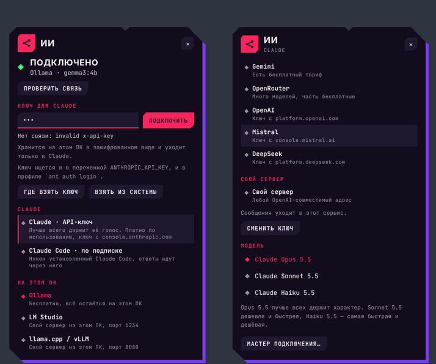

Если не хочется разбираться самому, нажми там **«Мастер подключения…»**: она сама задаст вопросы кнопками и всё настроит
(поставит Ollama, скачает модель, попросит ключ). То же самое есть в меню у часов › **ИИ-модель** › **Выбрать вместе с ней…**.
Мастер к тому же сам включается, когда ты впервые пытаешься с ней поговорить, а «мозга» ещё нет.

### Что выбрать

| Способ | Для кого | Деньги | Что уходит в интернет |
|---|---|---|---|
| **Claude (API-ключ)** | лучше всего держит её характер и русский | платно, по использованию | сообщения → Anthropic |
| **Claude Code** | у тебя уже есть подписка Claude | по подписке | сообщения → Claude Code → Anthropic |
| **Ollama** | хочешь бесплатно и приватно | бесплатно | ничего |
| **Groq / Gemini** | хочешь бесплатно, без мощного ПК | есть бесплатный тариф | сообщения → сервис |
| **Pollinations** | попробовать за минуту, без аккаунта | бесплатно | сообщения → сервис |
| **LM Studio / llama.cpp / свой сервер** | у тебя уже стоит локальная модель | бесплатно | ничего |
| **OpenAI, OpenRouter, Mistral, DeepSeek** | если уже есть ключ | платно | сообщения → сервис |

### Способ 1. Claude по API-ключу (рекомендую)

Это встроенное подключение к Claude через официальную библиотеку Anthropic (`src/main/anthropic.js`). Ответы идут потоком
(слова появляются по мере написания), а список моделей берётся прямо из твоего аккаунта.

1. Зайди на [console.anthropic.com](https://console.anthropic.com), создай аккаунт и пополни баланс (API оплачивается
   отдельно от подписки Claude).
2. Открой **Settings › API Keys** ([прямая ссылка](https://console.anthropic.com/settings/keys)) › **Create Key** и
   скопируй ключ (он начинается с `sk-ant-`, показывается один раз).
3. В Капри: правый клик › вкладка **ИИ** › **«Claude · API-ключ»** › вставь ключ в поле › **Подключить**.
4. Она проверит ключ (запрос к списку моделей) и, если всё хорошо, подключится. Дальше выбери **модель** в этой же вкладке.

**Модели.** По умолчанию берётся **Claude Opus 5.5**: он лучше всех держит её характер и отвечает живее всех. **Sonnet 5.5**
дешевле и быстрее, почти не хуже. **Haiku 5.5** — самая быстрая и дешёвая, для частой болтовни. Актуальные цены смотри на
сайте Anthropic. Её ответы короткие (одна-три фразы), так что расход небольшой, а на Haiku совсем маленький. Думает она
вполсилы (низкий уровень рассуждения), чтобы не заставлять тебя ждать.

Что ещё полезно знать:

- Ключ можно не вводить, если он уже есть в системе: переменная окружения `ANTHROPIC_API_KEY` или вход через
  `ant auth login`. Нажми **«Взять из системы»**.
- Если модель откажется отвечать на конкретное сообщение (по соображениям безопасности), запрос автоматически уйдёт на
  другую модель (серверный «fallback» Anthropic, включён по умолчанию для Opus и Sonnet 5.5), и она не замолчит. Если на
  твоём аккаунте этой функции нет, всё работает и без неё.
- **Зрение** на Claude тоже работает: включи **Чувства › Видеть мой экран**, и она будет смотреть снимки той же моделью
  (можно выбрать дешёвую, например Haiku 5.5, в «Модель зрения…»).
- Ключ хранится **зашифрованным** на этом ПК (учётной записью Windows) и уходит только на серверы Anthropic. Сменить или
  удалить: вкладка ИИ › **«Сменить ключ»**.

### Способ 2. Claude Code (по подписке, без API-ключа)

Если у тебя уже стоит [Claude Code](https://code.claude.com/docs/en/quickstart) и ты вошёл в свою подписку, Капри может
отвечать через него: сообщения уходят в `claude -p` («безголовый» режим) в выбранной папке, продолжая один разговор.

1. Установи Claude Code (`npm install -g @anthropic-ai/claude-code`) и один раз запусти `claude`, чтобы войти.
2. В Капри: вкладка **ИИ** › **«Claude Code · по подписке»**.
3. Папку проекта, в которой он работает, и права выбираешь в меню у часов › **ИИ-модель**. По умолчанию он **только
   читает** (режим `default`, потому что подтвердить правку здесь некому); можно разрешить правки без вопросов
   (`acceptEdits`).

Здесь Капри — оболочка над настоящим агентом Claude Code: он может реально работать в твоей папке, а в её пузыре
показывается итог. Блокнот «что она о тебе знает» в этом режиме не ведётся (агента не гоняют ради заметок).

### Способ 3. Бесплатно и на своём ПК: Ollama

Ничего не уходит в интернет, ключи не нужны. Нужен компьютер с 8 ГБ памяти и больше.

1. Вкладка **ИИ** › **«Мастер подключения…»** › **«На моём ПК»**.
2. Мастер сам установит [Ollama](https://ollama.com) через winget (встроенный установщик Windows), запустит её и предложит
   скачать модель: `gemma3` (3,3 ГБ, лучше по-русски) или `llama3.2` (2 ГБ, для слабых ПК). Скачивание идёт с полосой
   прогресса.
3. Готово: Капри подключается к Ollama на этом же компьютере (`127.0.0.1:11434`, или адрес из `OLLAMA_HOST`).

Для русского языка нужны модели покрупнее: `gemma3:4b` и больше. Совсем маленькие (1B и меньше) могут нести чепуху, и
Капри предупредит тебя и предложит модель получше. Если такая модель забудет скрытый тег настроения, она угадает настроение
по тексту.

Ничего выбирать не обязательно: при первом запуске Капри сама смотрит на твой ПК, берёт подходящую модель и ставит всё нужное
(раздел [«Подбор по твоему ПК»](#подбор-по-твоему-пк-ollama-chatterbox-и-piper-всё-готовится-само)).

Если Ollama у тебя уже стоит, мастер не будет ставить её заново: он только разбудит её (если она спит) и предложит скачать модель (если ни одной ещё нет). Другие пункты первого вопроса мастера: **«Онлайн, без аккаунта»** (Pollinations) и **«У меня есть ключ»** (облачные сервисы).

### Способ 4. Бесплатный облачный тариф

Не нужен мощный компьютер: берёшь бесплатный ключ и вставляешь во вкладке ИИ.

- **Groq** — [console.groq.com/keys](https://console.groq.com/keys) (быстро, хорошо понимает русский);
- **Gemini** — [aistudio.google.com/apikey](https://aistudio.google.com/apikey);
- **OpenRouter** — [openrouter.ai/keys](https://openrouter.ai/keys) (много моделей, часть бесплатные);
- **Pollinations** — вообще без ключа и аккаунта: просто выбери его в списке (чтобы попробовать).

В каждом случае: вкладка ИИ › выбрать сервис › **«Где взять ключ»** (откроет страницу) › вставить ключ › **Подключить**.
Такие же шаги для **OpenAI**, **Mistral** и **DeepSeek**, если у тебя уже есть ключ. Ключ она проверяет сразу и говорит,
если он не подошёл.

### Способ 5. Свой сервер

LM Studio (порт 1234), llama.cpp или vLLM (порт 8080) или любой OpenAI-совместимый адрес: вкладка ИИ › нужный пункт. Для
своего адреса выбери **«Свой сервер»** и впиши, например, `http://127.0.0.1:1234/v1`. Если адрес локальный (`127.0.0.1`
или `localhost`), она знает, что ответы остаются на твоём ПК, и говорит об этом в чате.

### Проверка связи и ошибки

Во вкладке ИИ сверху видно состояние (**Подключено** — зелёный ромб) и есть кнопка **«Проверить связь»**. Если что-то не
так, Капри скажет это в чате по-человечески:

| Что она говорит | Что делать |
|---|---|
| нет ключа, «Нет связи: no API key» | вставь ключ во вкладке ИИ |
| «Они не принимают этот ключ» | ключ неверный, отозван или с лишним пробелом: создай новый |
| «На счёте у них закончились деньги» | пополни баланс на сайте сервиса |
| «Их серверы перегружены» | подожди минуту; она сама пробует другую модель |
| «Они отказались отвечать на это» | сформулируй иначе |
| «Ollama не отвечает» | запусти «Мастер подключения…» (он поднимет её) |
| не видит Claude Code | проверь, что команда `claude` работает в терминале; перезапусти Капри |

Меню у часов › **ИИ-модель** повторяет те же выборы: список сервисов, моделей, **API-ключ или адрес…** и **«Забыть наши
разговоры»** (стирает то, что она помнит из чатов).

---

## Как подключить слежение за Claude Code, Codex и Antigravity

Это отдельная от чата вещь: она смотрит, что делает твой ИИ для кода, и реагирует. Для этого нужны её «хуки».

### Что такое Claude Code и нужен ли он

[Claude Code](https://code.claude.com/docs/en/quickstart) — помощник для программирования от Anthropic: в терминале, в VS
Code или во вкладке Code приложения Claude. Ему нужен платный тариф Claude (Pro и выше) или аккаунт API. Капри его только
**наблюдает**: ключа и платы за саму Капри нет. Без Claude Code она тоже живёт на твоём столе: летает, сидит на окнах,
смотрит на спутник, засыпает, болтает с тобой.

### Подключение в один клик

1. При первом запуске она представляется. Нажми **«Подключить меня к Claude»** (или правый клик › **Как это работает?** ›
   «Подключить меня к Claude», или меню у часов › **Установить хуки Claude Code**).
2. **Полностью закрой Claude Code и открой снова**: хуки он читает только в начале сессии.
3. Как только Claude что-нибудь сделает, она скажет **«Я вижу Claude! Мы на связи.»** Так ты узнаешь, что получилось.

### Подключение вручную

```bash
npm run hooks:install
```

Скрипт добавит хук в `~/.claude/settings.json` (рядом сохранится копия, твои хуки останутся). После этого перезапусти
сессии Claude Code. Убрать: `npm run hooks:uninstall` (или из её меню).

Хуки работают асинхронно: Claude они не замедляют, а когда Капри не запущена, ничего не делают. Хук отправляет события
только на `127.0.0.1` (порт 47823; если ты сменил порт переменной `CAPRI_PORT`, она должна быть задана и для Claude Code,
который запускает хуки). Если на компьютере нет Node.js (установка из `.exe`), хук запускается самой Капри в роли Node, так
что ничего ставить не нужно. Если Claude Code хранит настройки не в `~/.claude`, а в папке из `CLAUDE_CONFIG_DIR`, хук
ляжет туда. Если файл настроек повреждён (невалидный JSON), установщик его не трогает и говорит об этом.

### Бесплатный Claude Code через Ollama

На её приветствии есть кнопка **«Бесплатно через Ollama»**: она подключит хуки, поставит Ollama (если её нет) и откроет окно
с `ollama launch claude`, где ты выберешь модель. Для неё это обычный Claude Code, только медленнее: пока модель думает,
бегущая строка считает секунды.

### Codex или Antigravity вместо Claude Code

Правый клик по ней › **Что отслеживать** › **Codex** или **Antigravity**. Она поздоровается и предложит подключиться, как для
Claude Code. Дальше:

- **Codex**: перезапусти его и доверяй её хукам, когда он спросит. Они лежат в `~/.codex/hooks.json`. Хуку для Codex нужен
  [Node.js](https://nodejs.org) 18 или новее: Капри сама проверяет, есть ли он, и если нет, ставит переносной в свою папку и
  добавляет в PATH (шаг «Найти или поставить Node.js» в подготовке; отключается ключом `autoNode`).
- **Antigravity**: начни новый разговор. Хуки лежат в `~/.gemini/config/hooks.json`.

Из командной строки: `npm run hooks:codex:install`, `npm run hooks:agy:install` (с `:uninstall` — убрать). Тесты обоих
адаптеров: `npm run test:hooks`.

Она следит за одним из них за раз — тем, который выбран в меню, и её реплики, гид и чат называют его по имени. Она только
смотрит: когда Codex или Antigravity просит одобрения, отвечаешь ты, у них. Пункт **«Ничего, просто будь рядом»** отключает
слежение вовсе: она перестаёт говорить о них.

---

## Как ею пользоваться

Она ловит мышь только на самом теле (по пикселям): остальной экран работает как обычно.

- **Клик по ней:** скажет, как дела у Claude (если ничего не происходит, появится кнопка «Поговорить со мной»). Если кликнуть
  по голове, по ногам или дважды подряд, она ответит на это по-своему.
- **Мышь без слов:** и без нейросети она живая, реагирует сама, пока ничего не происходит: подошёл курсором, остановил его рядом
  на несколько секунд («Чего завис?»), затряс курсором из стороны в сторону, унёс её и поставил на пол или на окно (комментирует
  не всегда). Эти реплики лежат в `lines-life.js` (`mouse`), по-русски и по-английски.
- **Пока к ней не подключена нейросеть**, она так и говорит: на клик отвечает «мне нечем думать», а раз в 10 минут (первый раз
  через 4 минуты, не больше пяти раз за запуск) вспоминает об этом сама. У такой реплики есть кнопка **«Подключить»**: она
  открывает [главное меню](#главное-меню-первый-запуск). Пока идёт подготовка или главное меню открыто, она об этом молчит.
- **Перетащить:** переместить её по экрану. Отпустишь бёдрами на верхний край окна — сядет на него, в другом месте — упадёт.
- **Клик по панели:** закрывает её.
- **Правый клик:** круговое меню со всеми настройками.
- **Ctrl+Alt+C:** она прячется в свой биочип (как в сериале), остаётся только маска с закрытыми глазами в левом нижнем углу.
  Глаза откроются, только когда Claude понадобишься ты. Клик по маске (или ещё раз Ctrl+Alt+C) вернёт её.
- **Ctrl+Alt+Space:** говорить с ней голосом (если включён микрофон; можно сменить в настройках, ключ `pushToTalk`).
- **Чат:** Enter отправляет, Esc закрывает.
- **Меню у часов** (иконка на панели задач, рядом с часами; из кругового меню — «Ещё › Системное меню…»): телепорт,
  спутник, демо, «Как это работает?», отчёт о миссиях, чат, круговое меню, «Настроить её…», размер, цвет, голос, характер,
  чувства, руки, звук, экран, ИИ-модель, гулять, вселяться в окна, где она отдыхает, что отслеживать, анимации,
  отображение, язык, автозапуск, хуки, выход.

---

## Настройка

Все настройки — в **круговом меню** (правый клик по Капри). Сектор = вкладка; стрелки на клавиатуре переключают вкладки,
**Esc** или клик мимо закрывают. Меню рисуется в цветах её темы: перекрасишь её — перекрасится и оно.

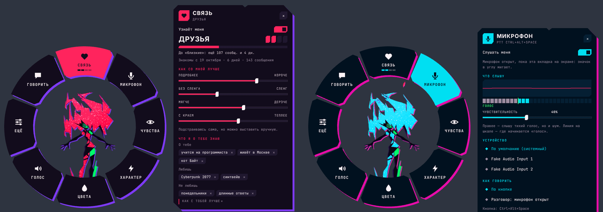

| Вкладка | Что там |
|---|---|
| **Связь** | уровень отношений, насколько вы близки, четыре «ручки» её поведения (короче ↔ длиннее, сленг, подколки, теплота), блокнот о тебе (можно убирать записи и добавлять свои), «Забыть всё обо мне» |
| **ИИ** | кто ей отвечает, ключ, модель, «Проверить связь», мастер подключения |
| **Микрофон** | включить, выбрать микрофон, чувствительность (линия на шкале — где начинается «голос»), живая волна и уровень, режим «по кнопке» или «разговор» |
| **Чувства** | зрение (видеть экран), танец под музыку, руки (окна и сообщения) |
| **Характер** | эмоции, свои занятия, «знать, что играет», DJ, саморазвитие, бродить по экрану, вселяться в окна, двигать окна, в которые она вселилась |
| **Цвета** | 7 тем и «по настроению» |
| **Голос** | как она говорит (молчит, ответы, всё), движок, громкость, **куда идёт звук** (колонки, наушники), проверочный звук, «Слышать свой микрофон» |
| **Ещё** | размер, язык, где она отдыхает, телепорт, спутник, «Как это работает?», «ИИ-модель…», **«Главное меню (нейросети)…»** (выбрать другие нейросети и голос в любой момент), **«Что стоит на компьютере…»** (сколько места занимает скачанное и удаление ненужного), спрятать её, системное меню |
| **Говорить** | открывает чат |

### Как меню ведёт себя с остальным

Пока меню открыто, она никуда не уходит и не засыпает, а всё остальное старается не мешать:

- запрос разрешения от Claude, «Говорить» и шаги её мастера **сами закрывают меню**: их нельзя пропустить;
- «Готово» и ошибки от Claude **ждут**, пока ты закроешь меню, и тут же показываются (под кольцом их было бы не видно);
- её болтовня при открытом меню не лезет в кадр;
- на вкладке **Микрофон** (и при «Слышать свой микрофон» во вкладке **Голос**) режим «разговор» **ставится на паузу**: можно
  кричать в микрофон и крутить чувствительность, ничего не уйдёт в нейросеть;
- убралась в чип или уснула до маски — меню закрывается вместе с ней; сменил язык, цвет или размер — меню перерисуется
  и встанет вокруг неё заново.

### Файл настроек

Всё пишется в `config.json` в папке данных. Лучше менять через меню, а не руками: приложение пишет файл само (одним
файлом, целиком или никак, и не чаще раза в 0,25 с). Самое нужное:

| Ключ | Что значит |
|---|---|
| `provider` | кто отвечает: `anthropic`, `claude`, `ollama`, `groq`, `gemini`, `openrouter`, `openai`, `mistral`, `deepseek`, `lmstudio`, `llamacpp`, `pollinations`, `custom` |
| `chatModel`, `visionModel` | модель для чата и для зрения (пусто — первая из доступных) |
| `customUrl` | адрес своего сервера (`provider: custom`) |
| `claudeCwd`, `claudeMode` | папка и права Claude Code в чате (`default` или `acceptEdits`) |
| `userName`, `persona`, `memories`, `myLines` | как она тебя зовёт, как ты хочешь её видеть, что помнить, твои реплики |
| `lang` | язык: `auto`, `ru`, `en` (`fr`, `es` и `pt` из старых файлов читаются как `auto`: язык системы, русский или английский) |
| `theme`, `scale`, `rest` | цвета, размер (0,45 / 0,6 / 0,8), где отдыхает (`corner` или `taskbar`) |
| `motion`, `render` | анимации (`auto`, `full`, `reduced`), способ рисования (`auto`, `gl`, `software`) |
| `voiceMode`, `ttsEngine` (`system`, `piper`, `chatterbox`, `openai`, `elevenlabs`, `custom`), `ttsRate`, `audioOut` | голос, его скорость и устройство вывода (Ollama, Chatterbox и Piper: [ключи ниже](#подбор-по-твоему-пк-ollama-chatterbox-и-piper-всё-готовится-само)) |
| `ears`, `converse`, `micDevice`, `micSensitivity`, `sttEngine`, `pushToTalk` | микрофон и распознавание речи |
| `vision`, `visionEvery`, `rhythm`, `hands`, `handsType`, `handsMouse`, `learn` | зрение, танец, руки (окна, сообщения, мышка и клавиши), саморазвитие |
| `emotions`, `life`, `dj`, `musicAware`, `wander`, `possess`, `possessMove` | характер и самостоятельность (`possessMove`: двигать захваченные окна) |
| `mindTune` | как она просит локальную модель на этом ПК: числа профиля и результат проверки ([подробно](#настройка-нейросети-под-задачи-и-под-твой-пк)); сама пишет, руками не нужно |
| `muted`, `volume`, `visible`, `displayId`, `welcomed`, `linked`, `provisioned`, `profileApplied`, `hardwareCache`, `motionAsked` | служебное: звук, видна ли она, на каком экране, что она уже показала и спросила, и осмотр твоего ПК (хранится две недели) |

---

## Что она умеет

### Как она появляется

При первом запуске она **хватается за твой экран**. Его края искрят красным, левая рука хлопает по краю, потом правая,
руки тянутся вдоль них, пока она подтягивается, и лицо бьёт в стекло (белая вспышка, чернильная, цвета разъезжаются,
экран трясётся). Она оглядывается, моргает, широко раскрывает рот на «привет» (рядом с лицом выскакивает тег с её именем),
отпускает правый край и машет когтистой рукой, снова хватается, смотрит, куда лететь, и отпускает: руки рассыпаются
осколками от кистей, голова приседает и ныряет вниз, на её место, где тело раскладывается из лица.

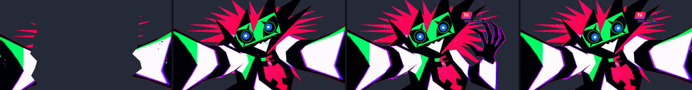

### Пока работает Claude

- **Бегущая строка над головой** показывает текущее действие (`ПРАВИТ gigs.ts`, `ЗАПУСКАЕТ npm test`, `ИЩЕТ "paginate"`…),
  а она роняет мелкие глифы данных. Когда Claude запускает команду или лезет в сеть, с её пальцев летят красные искры.
  Если она сидит на окне, она «втыкается» в него, и молния бежит по его рамке.
- **Когда Claude замолчал посреди работы** (думает или медленная локальная модель): через 15 секунд строка становится
  фиолетовой и считает секунды (`ДУМАЕТ… 45 с`), а она занимает себя (крутится, оглядывается, один раз смотрит на спутник).
  Через 40 секунд говорит об этом, через две минуты сообщает, что ничего не зависло.
- **Когда Claude нужна ты** (разрешение, вопрос): она телепортируется к твоей мыши, грива дыбом, и не отпускает её. Если ты в
  другом окне, она идёт к окну Claude и показывает на него пальцем (пунктир, скобки на углах, тег `CLAUDE`): вопрос там.
  Успокаивается, когда ты ответил.
- **Когда команда упала:** красный кадр-удар, её отбрасывает, сильный глитч и строка ошибки, которая действительно важна.
- **Когда всё готово:** она телепортируется в центр экрана и запускает победную последовательность: замах с втянутой
  гривой, растянутый кадр, затем руки вверх и взрыв гривы под манга-линиями скорости и ударной волной, безумный смех с
  аниме-вставкой её ухмылки. Потом сводка (например, «12 действий · 3 файла изменено · 2 мин 14 с») и последняя фраза Claude.
- **Когда Claude ответил, а ты в другом окне:** она показывает его ответ целиком, в широкой панели с прокруткой (абзацы,
  списки и код сохраняются). Панель уходит, когда ты вернулся в окно Claude или кликнул по ней. «Окно Claude» — то, в
  котором ты набрал запрос. Только Windows, как и слежение за окнами.

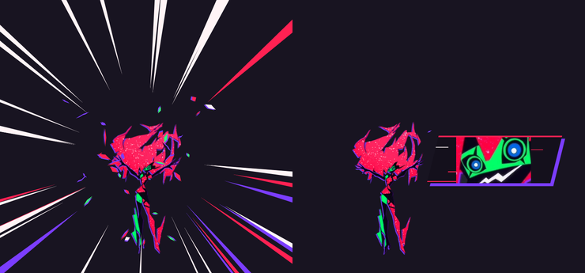

### Остальное время

Она парит, грива покачивается и роняет осколки, она дрейфует из угла в угол, поворачивается и склоняет голову, когда рядом
мышь (или, маленькая угроза, бьёт по ней красной молнией и хитро ухмыляется), смотрит на спутник и засыпает после 10 тихих
минут.

- **Сон.** Сначала дремлет, потом грива и тело распадаются, и остаётся то, что она есть по сути в сериале: зелёная маска и
  глаза, плывущие там, где она была, глаза закрыты. Иногда приоткрывает один. Поднеси мышь (или пусть Claude снова начнёт
  работать) — голубые глаза распахиваются, и она собирается вокруг них заново.
- **Спутник.** Большая последовательность, которую берегут для важных моментов: в первый раз за день, через некоторое
  время после долгой работы Claude (8 минут и больше, или 50 действий) или когда захочешь из меню. Белые крапинки её гривы
  поднимаются созвездием, выстраиваются дорогой от её пальцев к спутнику, она сжимается, и красный свет уходит вверх.
  Спутник отвечает ей, дважды мигнув. Всё это время её ничто не отвлекает, даже твоя мышь.

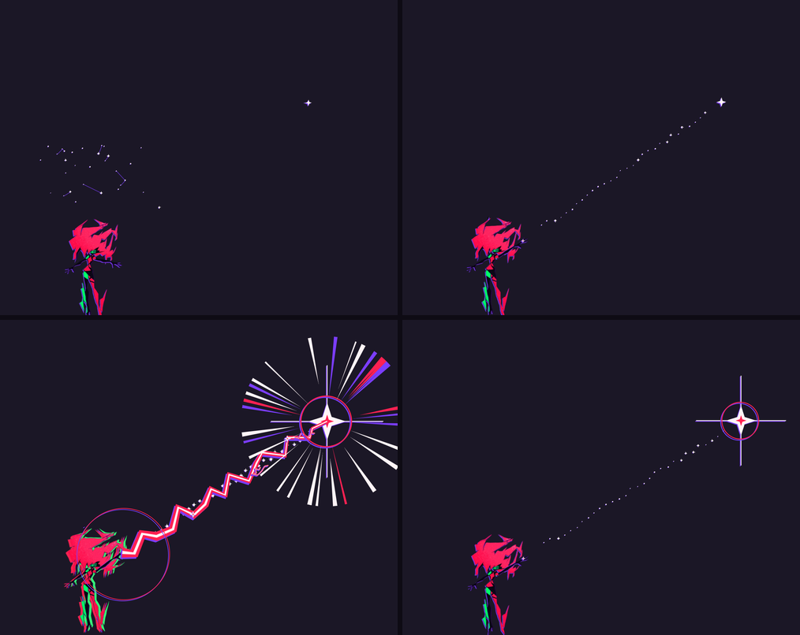

### Эмоции и характер

Каждое твоё сообщение в чате что-то с ней делает: **ещё до ответа нейросети** она реагирует телом. Потом нейросеть
получает её настроение и причину («ты назвал её дурой две минуты назад и не извинился») и отвечает в нём.

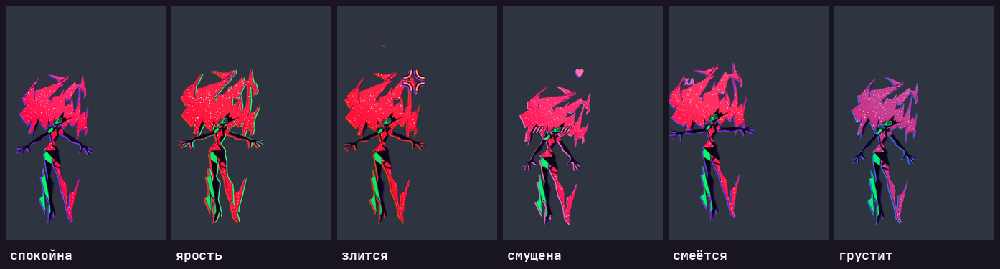

| Что ты делаешь | Что с ней |
|---|---|
| Оскорбляешь («дура», «заткнись», «ты бесполезная»…) | Злится. Несколько оскорблений подряд — **ярость**: красная вспышка, красные копии разлетаются, рык, а потом молния по твоему курсору |
| «Ты просто программа», «у тебя нет чувств» | Это её задевает: обида и злость |
| Называешь чужим именем (Алиса, Сири, ChatGPT, Люси…) | «Я КАПРИ.» |
| Грозишь удалить или выключить | Злится и пугается |
| Пишешь капсом | Вздрагивает |
| Повторяешь одно и то же, засыпаешь сообщениями | Раздражается |
| Вспоминаешь Арасаку, Militech, корпов | Фыркает: корпов она ненавидит |
| Смеёшься («ахаха», «лол»), просишь шутку | Хихикает, хохочет над своей же шуткой |
| Делаешь комплимент, «люблю тебя», обнимашки | Смущается: румянец, сердечко, отворачивается |
| Говоришь, что тебе грустно | Становится мягкой, тянется к тебе |
| Спрашиваешь про спутник, звёзды, космос | Мечтательно смотрит на спутник |
| Извиняешься | Остывает. Если была в ярости, одного «прости» мало, нужно два |
| Говоришь, что она неправа («ты ошибаешься») | Колется: чуть злится, но признаёт, если ты прав |
| Соглашаешься («ты права», «именно») | Довольная, чуть самодовольная |
| Делишься новостью («получилось!», «я сдал») | Радуется вместе с тобой |
| Жалуешься на жизнь, не на неё («опять не работает, бесит») | Встаёт на твою сторону, без нравоучений |
| Отмахиваешься («ладно», «ну такое») | Немного грустнеет, не давит |
| «Скучал по тебе» | Смущается и делает вид, что нет |

И без чата: много кликов подряд — «эй, хватит», потом взрыв; курсор туда-сюда по ней — щекотно; курсор у неё на голове —
поглаживание; потаскаешь её — кружится голова; долго не обращаешь внимания — скучает и находит себе занятие. Злость остывает
за несколько минут, но **обиду она помнит даже после перезапуска**, пока не извинишься.

**Переходы плавные.** Чувство растёт сразу, а **показывает она его с задержкой на спад**: после ссоры она не становится спокойной от слова
«прости», а проходит ярость, потом раздражение, потом остывание (около минуты-двух, дальше доходит дело до настоящего покоя), и нейросеть
в этот момент знает: «ты остываешь, ещё немного задета, оттаивай постепенно». Настроение входит на одном уровне, а выходит на более низком
(нет мигания на границе); есть оттенки («слегка раздражена», «раздражена», «зла», «в ярости»). Обычное дружелюбное слово посреди ссоры
тоже понемногу остужает её (чем вы ближе, тем быстрее). Что с ней происходит вокруг, тоже меняет её: утро, поздняя ночь, батарея
садится или подключили зарядку, пропала или вернулась сеть, ты долго не вставал из-за ПК, ты вернулся после нескольких часов (чем
дольше, тем сильнее она скучала). Нейросеть знает эти обстоятельства и может к ним придраться, если к слову. Настроение видно на её панели
(◆ ЗЛИТСЯ, ◆ СМУЩЕНА…) и вверху меню. Выключить: **Характер › Эмоции**.

### Голос

**Голос › Как она говорит:** молчит, озвучивает ответы чата или озвучивает всё, что говорит. Движки:

- **Системный** — бесплатно и без интернета, голоса Windows (по-русски Irina или Svetlana, если стоит русский языковой
  пакет). Высота и темп меняются от настроения: злая — ниже и быстрее, смущённая — выше.
- **Piper (лёгкий, на этом ПК, запускает она)** — небольшая нейросеть, которая говорит на процессоре за доли секунды, без
  Python и без видеокарты: годится любому 64-битному ПК. Голос ровнее и суше, чем у Chatterbox, зато быстрый и бесплатный, работает без интернета. Эмоций у него нет, поэтому
  настроение двигает только темп (весёлая чуть быстрее, грустная и скучающая медленнее, в пределах ±8 %), а сам он запускается
  с настройками «быстро, живо, с вариациями» (`--length_scale 0,94`, `--noise_scale 0,75`, `--noise_w 0,88`,
  `--sentence_silence 0,12`; Piper по умолчанию читает вслух ровнее и медленнее). Эти числа подобраны по тому, что делает каждый
  параметр, а не на слух. Если у тебя поставлено несколько голосов Piper на нужном языке, в этой вкладке между ними можно
  выбирать; свои голоса (`.onnx` и `.onnx.json`) кладутся в папку `piper/voices`. Капри сама скачивает программу и голос на языке, на котором говорит, а
  программу держит запущенной, пока говорит, и отпускает через три минуты тишины.
- **Chatterbox (на этом ПК, запускает она)** — самый живой нейронный голос, который работает на твоём компьютере: бесплатно,
  офлайн, русский среди 23 языков. Нужна видеокарта NVIDIA (от 8 ГБ) или Mac с чипом Apple: на процессоре он очень медленный.
  Капри сама находит его папку, ставит всё недостающее, запускает и останавливает вместе с собой, а настроение передаёт ему
  в виде параметров (злая — «эмоциональнее и быстрее», грустная — «спокойнее и медленнее»). Без образца голоса это
  собственный голос модели; **голос по образцу** описан ниже.
  Какой из двух голосов взять на твоём ПК, она решает сама: см. [«Подбор по твоему ПК»](#подбор-по-твоему-пк-ollama-chatterbox-и-piper-всё-готовится-само).
- **OpenAI** — нужен ключ OpenAI. Модель `gpt-4o-mini-tts` получает инструкцию, *как* говорить («зло, сквозь рык»).
  Внимание: OpenAI объявил, что **6 января 2027** отключает `tts-1`, `tts-1-hd` и `gpt-4o-mini-tts`; названная замена
  работает только через Realtime API, а не через `/v1/audio/speech`, который использует Капри. До этой даты всё работает как
  раньше, а надолго лучше брать Chatterbox или ElevenLabs.
- **ElevenLabs** — твой ключ и ID голоса из твоей библиотеки; с моделью `eleven_v3` настроение передаётся тегами.
- **Свой сервер** — любой, совместимый с OpenAI `/v1/audio/speech`, который работает на твоём ПК (адрес вида
  `http://127.0.0.1:8000/v1`), например openedai-speech. Kokoro русского не знает (en, es, fr, hi, it, ja, pt, zh), для
  русской Капри он не годится.

К голосу сервисов, Chatterbox и Piper подмешивается эффект «множества разумов»: две запаздывающие «плавающие» копии под её голосом и
цифровой оттенок. Включается и выключается в меню у часов (**Голос › Эффект «множества разумов»**). Ключ, адрес или голос
сервиса вводятся кнопкой **«Ключ, адрес или голос…»** в той же вкладке, проверка — **«Проверить голос»**.

**Куда идёт звук.** Там же выбираешь колонки или наушники: её писки, звуки и голос (Chatterbox, Piper и облачных сервисов) идут на
выбранное устройство (системный голос Windows всегда звучит на устройстве по умолчанию). Есть проверочный звук и
**«Слышать свой микрофон»** — проверить микрофон на выбранном устройстве. Микрофон при этом открыт и значок мигает только
пока вкладка на экране; лучше в наушниках, с колонками может свистеть.

**Голос Капри или похожий: образец голоса (Chatterbox).** Голос настоящей Капри в приложение не вложен: у неё нет
собственной записи, которую можно было бы поставлять и на которую у проекта есть права. Зато Chatterbox умеет говорить
голосом любой короткой записи, и Капри берёт её так:

1. Выбери голос **Chatterbox** (главное меню › «2. Чем она говорит» или вкладка **Голос** кругового меню).
2. Нажми **«Выбрать запись…»** и укажи файл `wav`, `mp3`, `flac` или `ogg`. Она копирует его в свою папку данных
   (`voices/capri.wav`) и дальше говорит этим голосом: новая запись заменяет старую, **«Убрать образец»** возвращает голос модели.
   Перезапускать ничего не нужно, следующая реплика уже звучит новым голосом.
3. Проверь кнопкой **«Проверить голос»**.

Что даёт хороший результат: речь **одного** человека, чистая, без музыки, шума и эха, **5–30 секунд** (берутся первые 20), не
тихая и не перегруженная (хрип). Лучше на том же языке, на котором она говорит: с чужим языком в образце может появиться акцент.
WAV она проверяет сама: меньше 2 секунд или почти тишину отказывается брать и объясняет почему, а короткую, тихую,
перегруженную или слишком длинную берёт, но предупреждает. Остальные форматы берутся как есть. Запись остаётся на твоём
ПК и никуда не отправляется (облачные голоса её не получают), она удаляется вместе с папкой данных при удалении Капри.
Образец главнее имени в `ttsVoice`; без образца действует имя из настроек (запись из папки `voices` в папке Chatterbox).

Это единственный способ получить конкретный голос: Piper и облачные голоса (OpenAI, ElevenLabs) голос по записи не копируют,
у них выбирается готовый голос. Как именно получится звучать у тебя, зависит от записи
и от модели; на слух результат при разработке проверить было нельзя, проверялся только путь записи до модели.

**Голос, который идёт в комплекте (необязательно).** Кто собирает установщик, может положить запись в `assets/voice-default/`
(`capri.wav`, при желании `capri.json` с `{ "lang": "en" }`: на каком языке в ней говорят). Запись лучше очистить: музыку и чужие голоса
убирает разделитель голоса (например `audio-separator`), а гул и шум между фразами `python tools/clean-voice.py in.wav out.wav`
(24 кГц, моно, фильтр от гула, мягкий спектральный гейт, обрезка тишины по краям). Она попадает в установщик, и при
первом запуске Капри берёт её голосом, если своей записи у неё ещё нет; убранная потом не возвращается. Если язык записи
известен и отличается от того, на котором она говорит, Chatterbox просят не тянуть акцент записи в речь (`cfg_weight = 0`, его
собственный совет на этот случай). Записи в git не попадают (`.gitignore`): это чей-то голос, в проекте их нет, а в установщике,
собранном без неё (например, на GitHub Actions), комплектного голоса просто нет.

**Если запись с музыкой.** Для образца нужен чистый голос. Если у тебя дорожка с музыкой или битом, голос лучше сперва отделить
(например, программой `audio-separator` с моделью UVR-MDX-NET-Voc_FT): иначе Chatterbox скопирует и музыку.

**Проверить, как звучат голоса.** `npm run voices:demo` (из папки с исходниками) находит Piper и Chatterbox в папке данных Капри
(Windows: `%APPDATA%\Capri`), записывает голоса по-русски и по-английски в `voice-samples/` и пишет `report.txt`; Chatterbox
записывается дважды, собственным голосом модели и голосом образца. `--sample путь\к\записи.wav` берёт другую запись,
`--only piper` или `--only chatterbox` только одно из двух. Это тот же код, которым она говорит сама.

> Не клонируй голос реальной актрисы или любого другого человека без его разрешения. Используй только записи, на которые у
> тебя есть право: свой голос, голос того, кто согласился, или запись с подходящей лицензией.

### Главное меню (первый запуск)

При самом первом запуске Капри открывает **главное меню**: окно, где ты за минуту выбираешь, на чём она будет думать и чем
говорить, и ставишь выбранное одной кнопкой. Потом оно открывается из меню у часов: **«Главное меню (нейросети и установка)…»**.
Пока ты не нажал **«Установить и запустить»**, ничего не скачивается и не ставится.

Сверху карточка **«Мой компьютер»** (процессор, память, видеокарта, свободное место) и профиль, который она советует для него.
Дальше три шага (и четвёртый раздел, про удаление: [ниже](#удалить-ненужное-и-саму-капри)):

1. **На чём она думает.** Три варианта:
   - **На моём компьютере (Ollama)**: бесплатно, приватно, без интернета. Видно, стоит ли Ollama и какие модели уже скачаны, и
     список моделей для разговора с размером каждой: `gemma3:1b` (0,8 ГБ), `4b` (3,3 ГБ), `12b` (8,1 ГБ), `27b` (17 ГБ). Помечено,
     какую она советует, какая уже скачана, какая видит экран и какая **тяжела для этого ПК**. Уже стоящие у тебя модели можно
     оставить как есть.
   - **В облаке (по ключу)**: Groq, Gemini (оба бесплатно), OpenRouter, Pollinations (без ключа и аккаунта), Claude, OpenAI,
     Mistral, DeepSeek или свой сервер. Выбираешь сервис, нажимаешь **«Открыть страницу, где берут ключ»**, вставляешь ключ,
     жмёшь **«Проверить и подключить»**: она тут же пробует ключ и пишет «Подключено: модель…» или почему не подошёл. Неверный
     ключ не сохраняется. У подключённого сервиса в списке пометка «подключено», у сохранённого ключа «ключ уже сохранён».
   - **Пока никак**: настроишь позже.
2. **Чем она говорит.** **Piper** (лёгкий, на процессоре), **Chatterbox** (самый живой, нужна видеокарта NVIDIA), **системный**
   (без установки) или **облачный** (OpenAI или ElevenLabs: вставляешь ключ и сохраняешь). Выбор, который она советует для
   твоего ПК, помечен «рекомендую».
3. **Установка.** Список того, что будет сделано, с размерами и пометками «уже есть» и «скачаю», итог «Скачать: 3,4 ГБ ·
   Свободно на диске: 120 ГБ» и предупреждения (мало места, Chatterbox на процессоре будет медленным, модель тяжела для
   этого ПК, сервис ещё не подключён). Кнопка **«Установить и запустить»**: те же шаги, что в окне подготовки, с полосами
   прогресса, прямо в этом же окне. Над списком стоит блок **«Куда всё скачивается»**: там выбирается папка для всего
   скачиваемого (см. [Куда она всё скачивает](#куда-она-всё-скачивает)). **«Остановить»** сразу прерывает всё, что идёт (pip,
   установщики, скачивание), и пишет «Останавливаю…», а потом «Остановлено»; **«Повторить»** продолжает с того, что осталось,
   **«Скопировать отчёт»** помогает, если что-то не вышло.

**Если закрыть главное меню, ничего не выбрав** (или нажать **«Пропустить, настрою потом»**), она запоминает «пока не надо»:
ничего не скачивается и в следующие запуски само не готовится (то, что уже стоит у тебя, она по-прежнему запускает). Когда
понадобится, открой меню у часов › «Главное меню» или вкладки **ИИ** и **Голос** кругового меню. Нажав кнопку, ты включаешь
подготовку при каждом запуске (`autoSetup`).

**Передумать можно в любой момент:** в круговом меню (правый клик по ней) на вкладке **«Ещё»** есть кнопки **«Главное меню
(нейросети)…»**, **«Что стоит на компьютере…»** (открывает то же окно сразу на разделе про удаление) и **«Папка для
скачанного…»** (сразу на выборе папки, куда всё скачивается). Главное меню есть и в меню у часов.

### Как идёт установка и что она проверяет

- **Полосы прогресса настоящие.** Установка Chatterbox (pip) показывает одну полосу на весь шаг: сначала пакеты, потом torch для
  видеокарты NVIDIA (это около 2,5 ГБ), с текстом вроде «Скачиваю torch: 1,2 из 2,7 ГБ (45%) · 12 МБ/с», а при распаковке
  «Устанавливаю скачанное…». Для этого она сама обновляет pip в окружении (в pip, который идёт с Python 3.11, нет вывода
  прогресса строками). Модель голоса тоже показывается одной полосой по всему скачиванию (около 3 ГБ, по размеру кэша Hugging
  Face, а не файл за файлом), а когда всё скачано и модель грузится в память, полоса бегает туда-сюда.
- **Одна общая полоса на весь голос.** Над шагами «Голос: Chatterbox» (в окне подготовки и в главном меню) стоит ещё одна: Python,
  пакеты, torch для видеокарты, модель и пробная фраза в одной шкале, с текстом «Голос готов на 42%, осталось около 12 мин».
  Время считается по скорости за последние 45 секунд и появляется не сразу, а секунд через восемь («считаю, сколько осталось…»);
  оно примерное (размеры пакетов и модели известны приблизительно, загрузка модели в память идёт со своей скоростью). Полоса
  идёт только вперёд и не доходит до 100%, пока всё не готово.
- **Она проверяет, что поставленное работает**, а не только что оно поставлено. Нейросеть просит ответить одним словом (один раз
  для этой Ollama и этой модели, результат записывается в `mindChecked`). У Chatterbox после установки смотрит, что torch и
  torchaudio одной версии и что torch видит видеокарту (иначе пишет, что голос будет медленным), пишет в отчёт то, что нашёл
  `pip check`, а после загрузки модели просит сказать пробную фразу (один раз, запись в `voiceChecked`). Если не получилось,
  причина видна в шаге, а не потом в ответе чата.
- **«Ошибка про llama-server» в ответе Капри** значит, что у Ollama не хватает файлов движка (установку прервали, например
  кнопкой «Остановить», или антивирус убрал файл). Теперь она говорит это человеческими словами и даёт кнопку **«Починить
  Ollama»** (она же есть в главном меню, в блоке про нейросеть): Ollama ставится заново поверх, модели остаются. Если после этого
  движка всё равно нет, это почти наверняка антивирус: добавь папку Ollama в его исключения.

### Куда она всё скачивает

По умолчанию всё скачанное лежит в её папке данных (в Windows это `%APPDATA%`, то есть диск C:). Если места на C: мало, выбери
другое: главное меню › шаг **«3. Установка»** › блок **«Куда всё скачивается»** › **«Выбрать место…»**. Выбираешь диск или
папку, а она сама создаёт там отдельную папку **`Capri`** (с пометкой `capri-folder.json` внутри, чтобы потом знать, что папка
её), и дальше в неё идёт всё: Ollama и его модели, Piper, Chatterbox с Python-окружением и своей моделью, Node.js и временные
файлы загрузок (pip и установщики работают в `Capri\temp`, а не в TEMP системного диска; после каждой подготовки эта папка
очищается). Если выбрать папку, которая сама называется `Capri` или уже помечена, она берётся как есть, без второй вложенной.

- В блоке видно, где лежит сейчас и сколько свободно на этом диске; предупреждение «может не хватить места» и итог «Скачать» считаются
  по диску выбранной папки.
- **Уже скачанное сначала остаётся на прежнем месте.** Новая папка нужна для того, что скачивается дальше. Прежнее она по-прежнему
  находит и умеет убрать («Что стоит на компьютере»), а перенести его в новую папку можно кнопкой (см. ниже).
  «Вернуть по умолчанию» делает наоборот.
- Выбранная папка не может быть внутри самой программы (её уберёт деинсталлятор) и должна быть доступна для записи. Пока что-то
  скачивается или убирается, место не меняется.
- Когда папка выбрана, Ollama (если его нет на ПК) ставится **распакованным zip прямо в неё**, вместе с моделями; обычный
  установщик и `winget` кладут его в `AppData\Local\Programs`, они остаются запасными способами. Ollama, который уже стоит у тебя,
  хранит модели там, где хранит. Python, если его нет, ставится Windows обычным способом (на системный диск); а окружение
  Chatterbox и все пакеты уже лежат в `Capri`.
- «Удалить всё, что поставила я» убирает и пустую папку `Capri`; если там лежит что-то твоё, она остаётся с твоим.

#### Перенести уже скачанное в другую папку

Выбрав новое место, ты увидишь кнопку **«Перенести уже скачанное сюда»** (она есть, только если что-то из того, что скачала
она, лежит не в выбранной папке). Первое нажатие показывает, что переносится, сколько это весит и сколько свободно на новом
диске; второе нажатие переносит. Переносятся только **её** вещи: Ollama, который она поставила zip-ом (вместе с моделями),
Piper с голосами, Chatterbox с окружением и моделью, Node.js. Всё, что положил или поставил ты, не трогается.

- **На том же диске** папка просто переименовывается: это мгновенно и не требует места. **На другом диске** сначала копия
  рядом (`<имя>.part`), потом проверка, что всё работает на новом месте (программа на месте, у Chatterbox Python-окружение
  запускается и пакет в нём есть), и только после этого настройки переключаются на новое место, а старое удаляется. Если не
  работает, ошибка, нехватка места или ты нажал **«Остановить перенос»**, копия удаляется, а старая папка остаётся нетронутой.
- Пока идёт перенос, она останавливает разум и голос (иначе они держат файлы), а по окончании запускает снова. Скачивание и
  удаление в это время недоступны. Старая папка `Capri` удаляется, если в ней не осталось ничего, кроме её пометки.
- Если место уже занято (в новой папке на этом месте что-то лежит), это не переносится и не затирается, она об этом пишет.
- **Перенёс папку сам, в Проводнике?** Выбери её новое место в том же блоке: она найдёт `ollama`, `piper` и `chatterbox` в этой
  папке и перепишет настройки, которые указывали на старое место (в нём уже ничего нет), и ничего не качает заново.
- Python и Ollama, поставленные самой Windows, и Ollama или папки, которые лежат у тебя, она не переносит.

### Удалить ненужное и саму Капри

Четвёртый раздел главного меню, **«Что стоит на компьютере»**, показывает всё, что занимает место из-за неё, и сколько:
модели Ollama (каждая отдельно), Ollama, Piper, Chatterbox (с Python-окружением и своей моделью), Node.js и Python 3.11, если
их поставила она. Рядом с каждой строкой стоит кнопка **«Удалить»** (нажимать нужно дважды: первое нажатие только спрашивает
«Точно?»), внизу итог «Всё, что поставила я: 3,4 ГБ» и две кнопки:

- **«Удалить всё, что поставила я»**: сначала пишет, что именно уйдёт и сколько места освободится, и ждёт второго нажатия.
- **«Удалить Капри целиком…»**: то же самое, а потом ещё сама Капри, её настройки и память.

Что она считает своим, а что нет. **Своё** она удаляет целиком: то, что лежит в её папке данных (Piper, Chatterbox, портативный
Node.js, Ollama из zip), и то, что она записала в `installed.json`, когда ставила: модели, которые она сама скачала в Ollama,
Ollama и Python, поставленные ею обычным способом (удаляются своим деинсталлятором или через `winget`). **Не своё** (папка
Chatterbox или Ollama, которую положил ты, Ollama, поставленная тобой, модели, скачанные тобой) она только показывает, чтобы
было видно, куда ушло место, и не трогает. Исключение: любую модель Ollama можно убрать по одной, если ты сам нажал «Удалить».

После удаления она **не докачивает это сама**: убранный голос становится системным, при удалении последней модели
выключается `autoMind`, при удалении Node.js `autoNode`. Вернуть можно в этом же меню, выбрав нужное в шагах 1–3. Пока идёт
подготовка, удалять нельзя. Если файл занят другой программой, она пишет об этом, а остальное удаляет. Всё, что она удаляет в
своей папке, она сначала проверяет: путь должен лежать внутри её папки данных, а не где-то ещё.

**Удаление при деинсталляции.** Когда ты удаляешь Капри сам (Параметры Windows › Приложения, или «Удалить Capri» в меню Пуск),
деинсталлятор спрашивает: «Удалить также всё, что Капри скачала и поставила сама?». **Да**: Капри один раз запускается без
окна (`Capri.exe --remove-everything`), убирает всё, что поставила, и деинсталлятор стирает её папку данных; освобождается всё
место. **Нет**: убирается только сама программа, как раньше. Тихое удаление (`/S`, `winget uninstall`) и обновление ничего не
спрашивают и ничего не трогают; чтобы тихое удаление тоже убрало скачанное, добавь `--remove-everything`.
Кнопка **«Удалить Капри целиком…»** делает то же из самого приложения. Если Капри запущена не из установщика (из исходников
или из папки), она убирает всё, что поставила, и просит тебя удалить саму папку.

### Настройка нейросети под задачи и под твой ПК

Поставить модель мало: одна и та же модель ведёт себя по-разному, если её просить болтать, вести блокнот или описывать экран.
Поэтому Капри просит её по-разному (`src/main/tune.js`; Ollama на твоём ПК; облачные сервисы остаются со своими настройками):

| Задача | Как она просит | Почему |
|---|---|---|
| **Болтовня** (её чат) | температура от 0,7 (модель до 2,5B) через 0,8 (до 6B) и 0,85 (до 20B) до 0,9 (крупнее); у маленьких ещё штраф за повторы (1,12 и 1,06); ответ до 240 токенов, по-русски 320, на «медленном» ПК не больше 200 | живая речь, но маленькая модель при высокой температуре теряет нить; по-русски те же три предложения занимают примерно вдвое больше токенов |
| **Заметки о тебе** (блокнот, каждые несколько сообщений) | температура 0,2, ответ до 768 токенов, режим JSON Ollama | это список для разбора программой: нужен один и тот же формат, а не фантазия. Раньше блокнот просили теми же параметрами, что и болтовню (температура 0,85, 240 токенов), и длинный JSON с полным блокнотом (до 28 пунктов) мог обрываться на полуслове: в 240 токенов он не помещается |
| **Взгляд на экран** | температура 0,3, ответ до 300 токенов | описание фактов |

Размер модели она читает из названия (`gemma3:4b`, `qwen2.5:7b`; если в названии размера нет, считает модель средней).
**Память разговора** подгоняется под её собственное описание: если запрос не помещается, память один раз вырастает на нужную
ступень (но не выше потолка профиля) и дальше не меняется, потому что смена размера заставляет Ollama загрузить модель заново.

**Проверка после установки.** Когда подготовка закончилась (и при смене модели) Капри один раз коротко просит модель написать
несколько слов и читает счётчики Ollama: сколько токенов в секунду и какая часть модели лежит в памяти видеокарты (`/api/ps`).
Это пара секунд; если ты в это время пишешь ей, проверка уступает. Результат хранится в `config.json` (`mindTune`) и верен
для этой модели на этом профиле ПК месяц; если проверка не получилась, следующая попытка не раньше чем через сутки. Что из
этого следует:

- **быстрее 25 токенов в секунду:** всё как в профиле;
- **6–25:** тоже без изменений, главное меню пишет «нормально»;
- **медленнее 6:** ответы не длиннее 200 токенов, модель держится в памяти 60 минут (загрузка заново медленнее всего), память
  разговора растёт не больше чем на одну ступень (длинный запрос дольше читается);
- **модель лишь частично на видеокарте:** главное меню так и пишет («на видеокарте на 50 %, остальное на процессоре»): это
  подсказка взять модель поменьше.

Всё это видно в главном меню, раздел **«4. Как я настроена под этот ПК»**: модель, скорость, где работает, память разговора и что
она просит для болтовни и заметок. Кнопка **«Проверить заново»** повторяет проверку. Раздел показывается, только когда отвечает
локальная модель.

**Чего это не делает.** Новую модель (файл с весами) она не создаёт и не дообучает: настройка меняет только то, *как* её
просят, без лишнего диска и без чистки при удалении. Значения взяты из того, что делает каждый параметр, и из рекомендаций
авторов моделей; качество ответов на каждой модели, какую можно поставить, не проверялось. Если какая-то модель ведёт себя
хуже, чем могла бы, напиши, какая и как: числа лежат в одном месте (`src/main/tune.js`).

### Подбор по твоему ПК: Ollama, Chatterbox и Piper (всё готовится само)

Её разум (**Ollama**, модель для разговора на твоём ПК) и её голос (**Chatterbox** или лёгкий **Piper**) нужны ей на каждом
запуске. Поэтому при старте она сначала **смотрит, что за компьютер**, потом подбирает под него нейросети, сама находит,
ставит, скачивает, настраивает и запускает недостающее. Никаких файлов добавлять не обязательно: всё, чего нет, она скачает
сама. Но чтобы не качать (или чтобы работало без интернета), можно положить готовое рядом с ней: список в
[«Что положить в папку с Капри»](#что-положить-в-папку-с-капри).

**Что она узнаёт о компьютере** (один осмотр, секунда-две, потом две недели помнит): систему и её разрядность (32 или 64 бита,
в том числе когда 32-битная Капри стоит на 64-битной Windows), процессор и число потоков, объём памяти, видеокарты с их
собственной памятью (для NVIDIA точно: драйвер и возможности карты), свободное место на диске. Ничего из этого никуда не
отправляется. **«Осмотреть заново»** в окне подготовки смотрит ещё раз (поменял видеокарту, добавил памяти).

**Профили.** По осмотру она берёт профиль. Его можно выбрать и самому (окно подготовки › **«Профиль загрузки»**):

| Профиль | Для какого ПК | Разум (Ollama) | Голос |
|---|---|---|---|
| **Облачный** | 32-битная Windows, памяти меньше 4 ГБ, не хватает места на диске | локальная модель не помещается: нейросеть из облака (ключ во вкладке **ИИ**); Ollama она не ставит | Piper, а где его нет (32-битная Windows) системный |
| **Лёгкий** | 4–7 ГБ памяти | `gemma3:1b` (0,8 ГБ; картинки не видит, по-русски простовата) | Piper на процессоре |
| **Средний** | от 7 ГБ памяти, без сильной видеокарты | `gemma3:4b` (3,3 ГБ; видит экран, хорошо по-русски) | Piper на процессоре |
| **Мощный** | видеокарта NVIDIA от 8 ГБ (или Mac с чипом Apple и от 16 ГБ памяти) и от 11 ГБ ОЗУ | по свободной памяти карты (после голоса): `gemma3:4b`, `gemma3:12b` (от 24 ГБ карты), `gemma3:27b` (от 32 ГБ) | Chatterbox на видеокарте |

Профиль всегда по силам ПК и по месту на диске: не хватает места, берётся профиль полегче, и она говорит об этом. Выбранный тобой
профиль она даёт, даже если он «выше» ПК (скажем, Chatterbox на процессоре), и предупреждает, чем это грозит. Видеокарты AMD и
встроенная графика для голоса не годятся (у Chatterbox только CUDA и Apple); пользоваться ли такой картой для модели, решает
сама Ollama.

**Какие нейронки ставить на какой ПК.** В главном меню, в блоке «Рекомендации для этого ПК», Капри пишет, что лучше всего
подойдёт именно тебе, и почему, а в списке моделей у каждой есть пометка: «рекомендую», «хорошая замена», как она говорит
по-русски, видит ли экран, «уже скачана», «тяжело для этого ПК». Это та же таблица, по которой она выбирает сама:

| ПК | Модель для разговора (Ollama) | Голос |
|---|---|---|
| 4 ГБ памяти, без видеокарты | `gemma3:1b` (самая лёгкая, экран не видит; лучше облачная нейросеть) | Piper |
| 8–16 ГБ, без видеокарты или видеокарта слабее 8 ГБ | `gemma3:4b`: видит экран, по-русски хорошо, идёт на процессоре без тормозов | Piper. Chatterbox тут будет очень медленным |
| 32 ГБ памяти и сильный процессор (12+ потоков) | то же `gemma3:4b` (всё крупнее на процессоре тормозит) | Piper. Chatterbox возможен, но медленный |
| NVIDIA 8–12 ГБ (RTX 3060, 4060…) | `gemma3:4b` целиком на видеокарте рядом с голосом | Chatterbox на видеокарте: быстро и живее всего |
| NVIDIA 24 ГБ (RTX 3090, 4090) | `gemma3:12b` (по-русски очень хорошо, видит экран); замена `qwen2.5:14b` (по-русски так же, экран не видит) | Chatterbox на видеокарте |
| NVIDIA 32 ГБ (RTX 5090) | `gemma3:27b` (лучше всего по-русски); замена `qwen2.5:32b` | Chatterbox на видеокарте |
| Mac с чипом Apple и от 16 ГБ | `gemma3:4b` | Chatterbox на чипе Apple (`mps`) |
| 32-битная Windows, меньше 4 ГБ | локальные не потянет: облачная нейросеть | системный (или Piper, если 64-битная) |

Почему так: модели `gemma3` от 4B понимают картинки (поэтому она может смотреть на твой экран) и хорошо говорят по-русски;
`qwen2.5` примерно на уровне по-русски, но картинок не видит. Видеокарту Капри делит между моделью и голосом: Chatterbox
занимает около 6,5 ГБ, поэтому на карте в 12 ГБ остаётся место под `gemma3:4b`, а не под `12b`. На процессоре сильно
больше 4B не имеет смысла: ответы станут слишком медленными. Размеры моделей: `gemma3:1b` 0,8 ГБ, `4b` 3,3 ГБ, `12b` 8,1 ГБ,
`27b` 17 ГБ, `qwen2.5:3b` 1,9 ГБ, `7b` 4,7 ГБ, `14b` 9 ГБ, `32b` 20 ГБ. Оценки «по-русски» приблизительные, это не замеры.

**Что она настраивает под профиль:**

- модель для разговора (скачивает, если у тебя нет подходящей: уже стоящая модель всегда главнее);
- сколько разговора модель помнит за раз и как долго держится в памяти (`num_ctx` 3072 / 4096 / 8192, 10–30 минут): на слабом ПК
  меньше, чтобы не душить память, но не меньше того, чему хватает места рядом с её собственным описанием (она занимает 1–2,5
  тысячи токенов; раньше на слабом ПК было 2048, и на разговор почти не оставалось места), а когда запросу всё же не хватает,
  память один раз вырастает до потолка профиля (4096 / 8192 / 16384); Ollama запускается с `OLLAMA_MAX_LOADED_MODELS=1` и `OLLAMA_NUM_PARALLEL=1` (твои значения из
  окружения она не трогает);
- голос: Chatterbox или Piper, устройство (видеокарта или процессор), для Piper голос **на языке, на котором она говорит**
  (русский: `ru_RU-irina`; английский: `en_US-amy`);
- сборка torch под твою видеокарту NVIDIA **и её драйвер** (`cu118`, `cu124`, а для новейших карт RTX 50 — `cu128`); если
  драйвер слишком старый ни для одной, остаётся процессор и она говорит об этом. На ПК без видеокарты тяжёлый torch для карты
  не ставится.

Подробнее о том, как она потом просит модель и как проверяет её на этом ПК, выше: [«Настройка нейросети под задачи и под твой ПК»](#настройка-нейросети-под-задачи-и-под-твой-пк).

**Куда класть и что у тебя главнее.** Папки Ollama, Chatterbox и Piper, в названиях которых есть `ollama`, `chatterbox`, `piper`
(регистр не важен), положи в папку с Капри (или рядом с ней). Она смотрит там, потом на рабочем столе, в «Загрузках», в
«Документах» и в домашней папке. Другое место можно показать кнопкой «Выбрать папку…» в окне подготовки. Что ты положил или
выбрал сам, главнее профиля: уже стоящая модель Ollama остаётся её разумом, папка Chatterbox рядом остаётся её голосом (на ПК
без видеокарты она предупредит, что он будет медленным; лёгкий Piper можно выбрать профилем «Средний»), а голос облачного
сервиса и разум не от Ollama она не трогает вовсе.

**Что она делает при запуске** (каждый шаг сначала смотрит, не сделан ли он уже, поэтому обычный запуск занимает секунды):

| Шаг | Что |
|---|---|
| Изучить компьютер | осмотр и выбор профиля (см. выше) |
| Найти или поставить Node.js | `node` в PATH, в папке установщика Node или в её собственной; нет (или версия ниже 18): на Windows скачивает переносной zip с nodejs.org (проверяет контрольную сумму, 32-битной Windows берёт подходящий выпуск), распаковывает в свою папку и добавляет в PATH твоей учётной записи. Установленная Капри в Node.js не нуждается, он нужен хукам Codex и запуску из исходников |
| Найти Ollama | её папка (с моделями из неё же), Ollama в PATH или обычное место установки; если Ollama уже работает (значок в трее), берёт её как есть. Нет нигде: ставит через `winget`, иначе скачивает установщик ollama.com, иначе zip с GitHub (без прав администратора) в свою папку |
| Запустить Ollama | `ollama serve` из её папки с её моделями и настройками профиля; при выходе из Капри останавливает только ту Ollama, которую запустила сама |
| Модель для разговора | есть подходящая: берёт её; нет: скачивает модель профиля |
| Найти или скачать Piper | программа Piper из папки рядом, иначе скачивает с GitHub (22 МБ) и распаковывает в свою папку |
| Голос на моём языке | голос Piper для языка Капри: в папке, иначе скачивает из каталога (около 60 МБ, с проверкой контрольной суммы) |
| Проверить голос | Piper говорит слово, чтобы убедиться, что всё работает |
| Найти папку Chatterbox | если выбран Chatterbox: см. выше; нет совсем: создаёт свою в папке данных |
| Python для голоса | свой Python в папке (`venv`, `.venv`, встроенный `python_embeded`); нет: системный 3.10–3.12; нет и его: установщик Python из папки рядом, иначе `winget`; потом свой `venv` |
| Установить Chatterbox | `pip install chatterbox-tts` (или из самой папки, если это исходники Chatterbox; с папкой `wheels` без интернета) и сборка torch под карту |
| Загрузить модель голоса | запускает свой маленький сервер вокруг Chatterbox (`chatterbox-server.py`) и ждёт, пока модель загрузится (в первый раз она ещё и скачивается, это несколько ГБ) |

**Окно подготовки.** Если что-то долгое (установка, скачивание) или что-то не вышло, открывается отдельное окно. Сверху карточка
**«Мой компьютер»**: процессор, память, видеокарта, свободное место, выбранный профиль («подобран автоматически» или «выбран
тобой»), одной строкой что взято и сколько скачать («Разум: gemma3:4b (3,3 ГБ) · Голос: Piper · Скачать: 3,4 ГБ»),
предупреждения (мало места, голос будет медленным, модель не видит картинок), список профилей с кнопкой **«Применить»** и
**«Осмотреть заново»**. Ниже группы шагов («Разум: Ollama», «Голос: Piper» или «Голос: Chatterbox»): у каждого шага значок,
что именно происходит и полоса прогресса. У неудавшегося шага написана причина и кнопки: **«Повторить»**, **«Выбрать папку…»**,
страница Ollama или Python, **«Подробности»** (последние строки журнала). **«Скопировать отчёт»** кладёт в буфер всё сразу: ПК,
профиль, шаги, ошибки, журналы Ollama, Chatterbox и Piper, чтобы показать, что пошло не так. Когда всё готово, окно само
закрывается через несколько секунд, а Капри говорит фразу новым голосом. В обычный запуск, когда всё уже стоит, окно не
открывается. Открыть его вручную: меню у часов **«Подготовка…»** или кнопка **«Подготовка…»** во вкладках **ИИ** и **Голос**
кругового меню. Если профиль облачный, в карточке есть кнопка **«Выбрать облачную нейросеть»**, она открывает вкладку **ИИ** (при первом запуске на таком ПК Капри открывает её сама).

**Смена профиля.** Выбрал другой профиль и нажал «Применить»: она заново выбирает голос (если он у неё был свой: Chatterbox,
Piper, системный) и берёт модель профиля (скачивает, если нет). После этого модель, выбранная тобой в меню, остаётся твоей.

**Первый запуск.** Сначала открывается [главное меню](#главное-меню-первый-запуск), и без твоего нажатия ничего не ставится.
Если голос у тебя ещё системный, а в меню выбрано «по рекомендациям», Капри берёт тот, что подходит ПК (один раз; потом уважает
любой твой выбор), а если разговаривает она через Ollama (это по умолчанию), готовит и её. Если ты выбрала Claude, ElevenLabs или другое,
того, что тебе не нужно, она не ставит: готовится только то, чем она сейчас пользуется. Выбрав Ollama, Chatterbox или Piper в
меню, ты запускаешь подготовку для них; сменив язык при голосе Piper, она докачает голос нового языка.

**Настройки** (`config.json`, меню «Ещё»):

| Ключ | Что |
|---|---|
| `profile` | `auto` (смотрит сама) или `cloud`, `light`, `standard`, `strong` |
| `hubDone` | `true`: главное меню уже показывалось и само больше не открывается; `false`: откроется при запуске, если ничего ещё не выбрано |
| `wantModel` | модель, которую ты выбрала в главном меню: подготовка скачает её, если её нет, и сделает моделью для разговора |
| `autoNode` | `false`: не искать и не ставить Node.js (по умолчанию `true`) |
| `autoMind` | `false`: не готовить Ollama и модель само (выключается, когда ты убрал последнюю модель; главное меню включает обратно) |
| `autoSetup` | `false`: не готовить при запуске (кнопка в меню всё равно работает); главное меню ставит `true` |
| `prepareWindow` | `false`: окно само не открывается (галочка в нём самом) |
| `ollamaDir`, `chatterboxDir`, `piperDir` | папки, если она не находит сама |
| `ttsEngine` | `system`, `piper`, `chatterbox`, `openai`, `elevenlabs`, `custom` |
| `chatterboxUrl` | адрес твоего уже запущенного сервера Chatterbox (например, `http://127.0.0.1:8004/v1`): тогда она ничего не ставит и не запускает |
| `chatterboxAuto` | `false`: не запускать Chatterbox самой (нужен свой адрес) |
| `chatterboxDevice` | `auto`, `cuda`, `cpu` или `mps`: где работает модель голоса |
| `ttsVoice` | для Piper: имя голоса из каталога (например, `ru_RU-irina-medium`) или файла `.onnx` у тебя |
| `hfEndpoint` | зеркало хранилища моделей (например, `https://hf-mirror.com`) для голосов Chatterbox и Piper, если huggingface.co у тебя не открывается |
| `chatModel` | модель Ollama для разговора |

**Если что-то не вышло.** Открой окно подготовки, нажми **«Скопировать отчёт»**. Частые причины: нет интернета для первой
загрузки (модель Ollama, голос Piper и модель Chatterbox качаются из сети; всё это можно положить заранее: см. ниже), мало места
на диске (профиль «Мощный»: 15–25 ГБ, «Средний»: около 5 ГБ), Python 3.13 и новее (для Chatterbox нужен 3.10–3.12), закрытый
huggingface.co (задай `hfEndpoint`). Chatterbox на процессоре работает, но медленно: на видеокарте NVIDIA ощутимо быстрее, а
на обычном ПК быстрее и ровнее Piper. Пока модель голоса грузится, Капри говорит системным голосом.

#### Что положить в папку с Капри

Обязательно не нужно ничего: она скачивает сама. Всё из таблицы **необязательно** и нужно, чтобы ничего не качать или работать
без интернета. Папки кладутся рядом с Капри (с её `.exe` или с папкой проекта), на рабочий стол, в «Загрузки» или «Документы»:
она ищет по слову в названии папки.

| Что положить | Как назвать папку | Что внутри | Что это пропускает |
|---|---|---|---|
| Ollama без установки | `ollama` (любое название со словом ollama) | распакованный [`ollama-windows-amd64.zip`](https://github.com/ollama/ollama/releases/latest) (в нём `ollama.exe`), для ARM64 `ollama-windows-arm64.zip` | установку Ollama (winget, установщик, zip) |
| Модели Ollama | `models` внутри папки `ollama` | содержимое `C:\Users\ТЫ\.ollama\models` с другого ПК, где модель уже скачана (`ollama pull gemma3:4b`); папки `blobs` и `manifests` | скачивание модели (1–17 ГБ) |
| Chatterbox | `chatterbox` | свой Python с Chatterbox: `venv` или `python_embeded`; либо исходники Chatterbox с `pyproject.toml` | создание окружения и установку пакета |
| Модели Chatterbox | `huggingface` внутри `chatterbox` | папка `C:\Users\ТЫ\.cache\huggingface` с ПК, где Chatterbox уже запускался | скачивание модели голоса (несколько ГБ); Капри читает её оттуда |
| Колёса для pip | `wheels` рядом или в `chatterbox` | файлы `.whl`: `pip download chatterbox-tts -d wheels`; для видеокарты ещё `pip download torch==2.6.0 torchaudio==2.6.0 --index-url https://download.pytorch.org/whl/cu124 -d wheels` (на ПК с той же Windows и Python 3.11) | скачивание пакетов, в том числе тяжёлого torch для карты |
| Python | сразу в папку с Капри или в `python`, `installers` | установщик с python.org: `python-3.11.9-amd64.exe` (3.10–3.12; для 32-битной Windows `-win32`) | установку Python через winget |
| Piper | `piper` | распакованный [`piper_windows_amd64.zip`](https://github.com/rhasspy/piper/releases/tag/2023.11.14-2) (внутри `piper.exe` и `espeak-ng-data`) | скачивание программы (22 МБ) |
| Голоса Piper | `voices` внутри `piper` | пары файлов `ru_RU-irina-medium.onnx` и `ru_RU-irina-medium.onnx.json` из [каталога голосов](https://huggingface.co/rhasspy/piper-voices/tree/main) | скачивание голоса (около 60 МБ) |

Минимум, чтобы Капри на новом ПК заговорила **совсем без интернета**: папка `ollama` с `models` (`gemma3:4b`), папка `piper`
с одним голосом. Для Chatterbox на видеокарте: папка `chatterbox` с готовым `venv`, `huggingface` и драйвер NVIDIA.

### Цвета

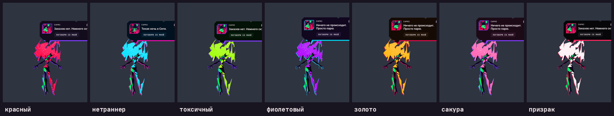

Красный (как в аниме), нетраннер (циан), токсичный (кислотно-зелёный), фиолетовый, золото, сакура (розовый), призрак
(белый) — и **по настроению** (злая — красная, грустная — синяя, смущённая — розовая, весёлая — золотая, скучающая —
белая). Меняется всё: грива, цветная «тень» (смещённая копия), панели, молнии, осколки и само круговое меню. Меняется
во вкладке **Цвета** или словами в чате: «перекрасься в синий», «стань розовой», «верни как было», «перекрасься под
настроение».

### Своя жизнь

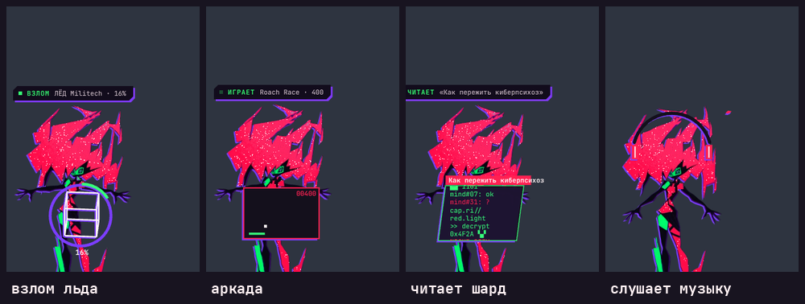

Когда ничего не происходит, она находит, чем заняться, и пишет это в бегущей строке над головой: **взламывает лёд**
Арасаки, Militech или Biotechnica (удалось — радуется, сработал чёрный лёд — её отбрасывает), играет в **аркаду** (и бесится,
проиграв), читает **дата-шарды**, рисует неоновое **граффити** прямо на твоём экране, **сканирует сеть**, спорит с другими
разумами внутри себя, потягивается.

**Музыка** (Windows): она знает, что играет (название и исполнитель; Spotify, браузер, Яндекс Музыка, AIMP… всё, что
сообщает Windows), надевает наушники и качает головой в такт, иногда высказывает мнение. В **режиме DJ** сама переключает
трек, когда ей надоело (не чаще раза в 20–35 минут и никогда не тот, что ты только что включил); в тишине предложит что-нибудь
включить.

**Ты:** встретит, если тебя не было больше 5 минут, поздоровается утром, в три часа ночи скажет, что пора спать, при
батарее ниже 15% пожалуется на холод. Всё это отключается во вкладке **Характер**.

### Чувства: зрение, слух, танец

Всё это **выключено по умолчанию**: каждое — доступ к экрану, звуку или микрофону, поэтому включается вручную (вкладки
**Чувства** и **Микрофон**). Пока чувство включено, внизу слева горит значок (◉ ВИЖУ, ● MIC), а на иконке у часов
написано, какие датчики сейчас работают, чтобы ни один не работал втихую. Ничего не записывается, а каждый кусочек данных
уходит только в тот сервис, который выбрал ты (локальный оставляет его на твоём ПК).

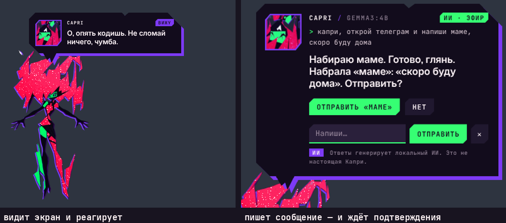

- **Зрение.** Время от времени (и по просьбе «посмотри на экран», «что у меня на экране?») она делает маленький снимок экрана,
  показывает его модели зрения и реагирует в своём стиле. Перед снимком прячет саму себя; снимок **нигде не сохраняется** и
  уходит только в выбранную модель. Работает с Claude (Opus, Sonnet, Haiku), локальными `qwen2.5vl` и `llava` в Ollama и
  облачными `gpt-4o-mini`, Gemini, Llama-4-Scout. Её чат знает, что она видела. Как часто смотрит сама — настройка
  `visionEvery` (по умолчанию раз в 45 секунд, `0` — только по просьбе). Модель зрения выбирается в **Чувства › Модель зрения…**.
- **Танец под музыку.** Она слушает **реальный звук системы**, ловит бит по басу и качается, машет гривой и крутится в такт
  (громче — шире). Только громкость и ритм: ни названий, ни записи.
- **Слух и голос.** Жми **Ctrl+Alt+Space** (или кнопку микрофона) и говори: она запишет, распознает речь и ответит, а если
  включён голос — **вслух**, так что можно общаться совсем без рук. Запись останавливается сама, когда ты замолчал.
  **Режим разговора** — микрофон остаётся открытым, вы говорите по очереди. Если ты скажешь что-то, пока она ещё отвечает,
  фраза не пропадёт: она уйдёт ей сразу после ответа. Распознавание: **Groq** (бесплатный тариф, хорошо понимает русский),
  **OpenAI** или свой сервер (whisper.cpp, faster-whisper). Выбрать: **Микрофон › Распознавание речи…**. Вкладка
  **Микрофон** показывает, что она слышит: живую волну и уровень, линию «отсюда начинается голос» и устройство, которое
  можно сменить на лету.

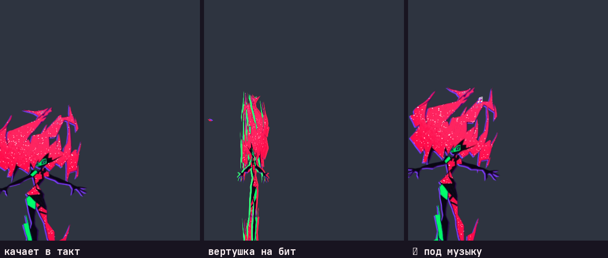

### Руки: окна, мышка, кнопки, клавиши, сообщения (Windows) и браузер

Выключено по умолчанию: вкладка **Чувства › Работать с окнами**. Тогда в чате (и голосом) можно:

- **Окна:** «сверни окно хрома», «разверни телеграм», «переключись на VS Code», «покажи рабочий стол». Делает сразу.
- **Сообщения** (если включено «Писать сообщения»): «капри, открой телеграм и напиши маме, скоро буду дома», «напиши в
  дискорде каналу general: тест». Она откроет приложение, найдёт чат и **наберёт сообщение, но не отправит**: сначала покажет
  **кому** и **что**, и кнопку «Отправить». Отправит только после твоего клика. Если во время набора на передний план выскочит
  другое окно, она **остановится**, а не напишет не туда. Текст идёт через буфер обмена, а твой скопированный текст
  возвращается на место.
- **Мышка** (переключатель **Двигать мышку, жать кнопки и клавиши**, по умолчанию включён вместе с руками): «подвинь мышку в
  центр» (углы, середины сторон, «в точку 500 300»), «кликни», «правый клик», «двойной клик», «прокрути вниз на 5». Указатель
  идёт плавно, настоящий: **если ты схватишь мышку, она тут же останавливается** («Ты взял мышку — я остановилась»).
- **Кнопки и пункты окон по имени:** «нажми «Сохранить» в блокноте», «нажми кнопку ОК в калькуляторе», «наведи мышку на «Файл»
  в блокноте». Она ищет элемент по имени в дереве доступности Windows (UI Automation: кнопки, пункты меню, ссылки, вкладки),
  подводит к нему указатель и нажимает (через «Invoke», а где его нет, кликом). Название в кавычках или после слова «кнопку».
- **Клавиши:** «нажми ctrl+s в блокноте», «нажми f5 в хроме», «нажми enter в…» (русские буквы по месту на клавиатуре: «контрол с»
  это Ctrl+C). Нужно имя окна: без него она спрашивает, в каком. Комбинацию собирает из списка клавиш, а не из твоих слов;
  `Alt+F4` и `Ctrl+Shift+Esc` не нажимает (закрытие окон у неё через кнопку подтверждения).
- **Текст в окно:** «напиши в блокноте: привет» (без Enter; через буфер обмена).
- Названия окон она понимает по-русски («в блокноте», «в хроме», «в калькуляторе») и ищет настоящее имя программы.
- **Что просит нейросеть тегом** (`[[click: окно | кнопка]]`, `[[keys: окно | ctrl+s]]`, `[[type: окно | текст]]`,
  `[[mouse: move | center]]`, `[[mouse: click]]`, `[[mouse: scroll | down 5]]`), делается **только за кнопкой**, которая пишет, что
  именно будет сделано, и только когда ты просил что-то подобное. Сказанное тобой самим делается сразу.
- Всё это отдельные скрипты PowerShell: твои слова попадают в них только как base64-данные (или как целые числа, или имя из
  фиксированного списка), никогда как код.

#### Браузер: прямые запросы и видео

Работает в чате без включения «рук» (она только открывает адрес в твоём браузере, ничего не нажимает за тебя):

- **Поиск:** «загугли рецепт борща», «найди в яндексе погоду на завтра», «поищи в интернете лучшие наушники», «найди на карте кафе
  рядом», «найди в википедии…», «на гитхабе…», «в картинках…», «search bing for cheap flights». Она сама собирает адрес поиска в
  нужной системе (Google, Яндекс, Bing, DuckDuckGo, YouTube, Wikipedia, GitHub, Карты, Картинки) и открывает его.
- **Видео:** «включи видео про котов», «включи Дудя на ютубе», «покажи ролик, где кот падает», «play a video about black holes»:
  она находит **первое видео** в результатах YouTube и открывает его страницу (оно начинает играть); если выбрать одно не вышло,
  открывает страницу результатов и говорит об этом. «Найди видео про космос» показывает результаты, не включая.
- Фраза считается просьбой, только если она **начинается** как просьба (глагол первым): «найди ошибку в коде» или «я вчера хотел
  найти в гугле одну штуку» ничего не открывают. То, что нейросеть просит тегом (`[[search: google | …]]`, `[[video: …]]`),
  открывается только за кнопкой с понятной надписью. Браузеру отдаются только https-адреса этих сайтов.
- Музыка («включи музыку Bad Bunny») по-прежнему идёт в Spotify.

Поддерживаются **Telegram, Discord, WhatsApp и Slack** (десктопные версии, стандартные горячие клавиши поиска). Окон самой
Капри, Claude и Ollama она никогда не трогает.

### Она узнаёт тебя (саморазвитие)

Включено по умолчанию (**Характер › Узнаёт меня**), и всё хранится только на твоём ПК (`bond.json`).

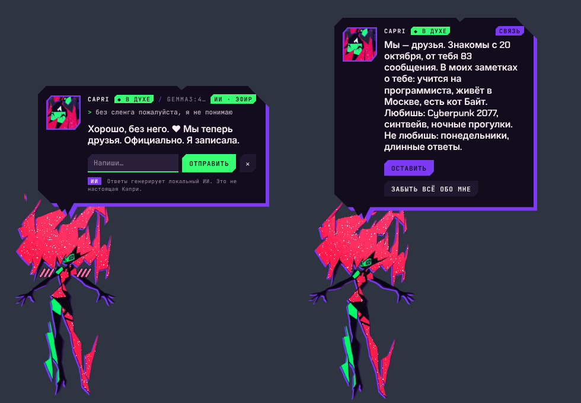

- **Как ты пишешь:** длина сообщений, смайлы, мат, «ты» или «вы», как часто ты смеёшься и спрашиваешь, в какие часы ты тут.
  Только счётчики и средние, сами сообщения здесь не хранятся. Пишешь коротко — отвечает коротко; материшься по привычке
  (не на неё) — перестаёт фыркать.
- **Как ты принимаешь её ответы:** посмеялся, «спасибо», «круто» после короткого дерзкого ответа — она чуть больше в эту
  сторону; «бред», «скучно», «неправильно» — в обратную. Прямые просьбы работают сразу и навсегда: «давай покороче»,
  «а подробнее?», «без сленга», «не шути», «будь милее», «подколи меня».
- **Что ты о себе рассказываешь:** каждые несколько сообщений (и при закрытии чата) её же нейросеть делает записи в блокнот:
  чем занимаешься, что любишь и не любишь, как с тобой лучше говорить. Пароли, телефоны, адреса, номера карт и документов,
  здоровье и деньги туда не попадают (и фильтр вырежет их в любом случае). Когда чатом работает Claude Code, блокнот не ведётся.

Чем дольше вместе, тем ближе: **незнакомцы → знакомимся → друзья → близкие → один из нас**. Она сообщает, когда это
меняется (♥), и это заметно: незнакомцу она задаёт вопросы о нём самом, друга подкалывает и напоминает его же слова,
близкому говорит правду, даже если она колет. Если ты постоянно груб с ней, близко не подпустит.

**Что ещё складывается между вами** (всё тоже только на твоём ПК, в `bond.json`, поле `rel`):

- **Доверие** (0…1): растёт, когда вы **миритесь после ссоры** (это ценнее тихого дня), когда ты делишься новостями, жалуешься или
  заходишь день за днём; падает от оскорблений, а после долгого отсутствия (две недели) чуть остывает и возвращается с днями. Нет
  доверия или она тебя не любит (настроение, `affection`) — выше уровня «друзья» или даже «знакомимся» не поднимешься, сколько бы ты ни писал.
- **Дни подряд и ссоры.** Неделя подряд и месяц подряд, а также каждая ссора, после которой вы помирились (до пяти), считаются
  как несколько сообщений при подсчёте уровня. Она помнит и говорит об этом: «вы три раза ругались и мирились: поэтому ты ей ближе
  чужого», «ты заходишь девятый день подряд».
- **Отсутствие.** Если ты не писал ей несколько дней, первое сообщение она встретит так, будто заметила (укор или «скучала», без
  речей); чем дольше, тем заметнее. Такое сообщается нейросети один раз.
- «Что ты обо мне знаешь?» теперь называет и это.

Вкладка **Связь** показывает уровень, прогресс до следующего, с какого дня вы знакомы, четыре «ручки» поведения и блокнот
(можно убирать записи крестиком и дописывать свои). Спроси в чате «**что ты обо мне знаешь?**», посмотри всё в меню
(**Характер › Что она обо мне знает…**, там же кнопка стереть) или скажи «**забудь всё обо мне**».

### Круговое меню

Правый клик по ней — и вокруг неё раскрывается кольцо в её цветах (см. [Настройка](#настройка)). Если выбрать тему, меню
меняется вместе с гривой. Каждый сектор — вкладка, карточка рядом с кольцом.

### Её чат

**Поговорить с ней** — в круговом меню, меню у часов или кнопка «Поговорить со мной» при клике на неё. Ты пишешь в её
панели, она отвечает в характере и знает, что делает Claude и что он успел за сегодня. Отвечает письменно и **на том языке, на
котором ты ей написал или сказал** (по словам в сообщении; если оно слишком короткое, на языке её меню), а читает ответ голосом того
языка, на котором он написан. Небольшие модели Ollama любят съезжать в английский из-за английской основы её описания, поэтому язык
сказан три раза: в начале её описания, в конце и приметкой к твоему сообщению; а если ответ всё равно пришёл по-английски на
русские слова, она просит ту же модель перевести его и показывает только русский. Если ты сам просишь перевод или пример на
английском, ответ остаётся английским.

**Как она говорит.** У неё подробный первый промт (`persona.js`, на языке ответа: по-русски и по-английски): кто она, как держится,
и главное, чего **не** делает. Суть в первой фразе, 1–3 предложения живой речи, **почти без вопросов** (никаких «а ты как?», «чем
помочь?», «что у тебя на уме?» в конце по привычке: спрашивает, только если без ответа не продолжить), своё мнение вместо
«зависит от обстоятельств», зацепка за то, что ты написал, а не общие фразы, слова Найт-Сити редко и не в каждом ответе, никакого
тона ассистента («дай знать, если…», «надеюсь, помогло»), без markdown и эмодзи; к промту добавлены примеры манеры. Если небольшая
модель всё равно начала с «Конечно!» или закончила шаблонным вопросом, это **снимается с готового ответа** (пока ответ идёт, начало
«Конечно!» не показывается); настоящий вопрос по делу остаётся. Для маленьких ПК память профиля «лёгкий» поднята с 3072 до 4096
токенов, чтобы длинный русский промт помещался с запасом на разговор.
Подробнее о том, что именно она знает при ответе и откуда берётся её поведение, написано в [Что уходит с твоего компьютера](#что-уходит-с-твоего-компьютера).

**Это ИИ.** Её ответы пишет модель, а не сценаристы сериала: это фанатская версия, и панель чата напоминает об этом каждый раз.

**Что она умеет на твоём ПК** (Windows), когда ты просишь в чате:

- **Открыть приложение или игру:** всё из меню «Пуск» (включая приложения из Магазина, например Spotify), твои игры Steam и
  Epic («открой Spotify», «запусти Brawlhalla»). Если ты назвал приложение своими словами, оно открывается сразу; если оно
  появилось только в ответе нейросети, сначала будет кнопка.
- **Музыка:** «пауза», «следующий», «громче», «без звука»… Она нажимает медиаклавиши, поэтому работает со Spotify и почти
  любым плеером сразу после отправки. «Поставь Daft Punk в Spotify» открывает Spotify на поиске (приложение, если оно есть,
  иначе сайт). Слова вроде «продолжай» или «следующий вопрос» в обычном разговоре клавиши не нажимают.
- **Сайт:** всегда за кнопкой, где написано, куда он ведёт.
- **Поиск и видео в браузере:** «загугли…», «найди в яндексе…», «включи видео про…», «включи… на ютубе»: сразу, см.
  [«Браузер: прямые запросы и видео»](#браузер-прямые-запросы-и-видео).
- **Мышка, кнопки окон, клавиши, текст в окно:** см. [«Руки»](#руки-окна-мышка-кнопки-клавиши-сообщения-windows-и-браузер).
- **Закрыть приложение** («закрой AM Music», «выключи дискорд»): кнопка с названием приложения, и ничего не случится, пока
  ты не нажмёшь её. Она закрывает его так же, как его собственная кнопка закрытия, поэтому оно ещё может спросить, сохранить
  ли. Если оно только спряталось в трей, она предложит **«Закрыть принудительно»** — опять только по твоему клику (несохранённое
  пропадёт). Системные части Windows, Claude, Ollama и саму себя она не закрывает.
- **Сменить цвет, имя, запомнить что-то:** «перекрасься в синий», «зови меня Лея», «запомни, что мою кошку зовут Неко».

Больше ничего: файлов и экрана (без включённого зрения) она не видит.

### Сделай её своей

Правый клик › **Настроить её…** (или «Настроить меня» в её гиде), по одной панели, каждую можно пропустить:

- **Как она тебя зовёт.** Использует имя время от времени и здоровается им, когда выходит на связь.
- **Какая она**, твоими словами («больше подкалывай, и говори со мной про Найт-Сити»): чат это учитывает, она остаётся
  Капри.
- **Твои реплики**, которые она говорит время от времени вместе со своими, когда ты кликаешь по ней. Напиши `{name}`, и она
  подставит твоё имя.
- **Что помнить** (твоя любимая игра, кошка…): её чат держит это в уме.

Всё это хранится в её настройках на твоём ПК.

### Как она перемещается

- **Сидит на твоих окнах:** на верхнем краю окна, болтая и пиная ногами по очереди. Едет вместе с окном, когда ты его
  двигаешь (помощник смотрит на окна каждые 40 мс, пока что-то движется), и падает, когда ты его закрываешь, сворачиваешь,
  разворачиваешь на весь экран или перекрываешь другим окном. Если окно наполовину ушло за край экрана, она остаётся на
  его видимой части, а если целиком, падает. Пока Claude работает, она пересаживается на окно, которое впереди, если получится.
  Если окно сдвинулось, пока она была занята (телепорт, действие), она догоняет его сама, а при падении садится туда, где
  окно стоит сейчас, а не там, где оно было. «Спрыгнув» с окна, она падает вниз, на следующее окно или на пол, а не садится
  обратно на то же.
- **Сидит на панели задач** (меню у часов › «Когда она отдыхает»): её ноги свисают поверх панели. Панель задач сама
  поднимается над другими окнами, когда открывается окно, переключается программа или появляется меню, и ноги пропадали;
  теперь помощник видит, что панель оказалась над ней, и Капри сразу поднимается обратно.
- **Выглядывает из-за краёв экрана:** наполовину спрятавшись слева или справа или свисая вниз головой сверху. Она стеснительная:
  поднеси мышь, и она уйдёт к другому краю.
- **Падает:** вытянувшись, с развевающейся гривой, ускоряясь, потом сильный сплющенный кадр и фонтан осколков при
  приземлении. По дороге её может поймать край окна.
- **Брось её на окно:** перетащи и отпусти бёдрами на верхний край окна — сядет. В другом месте — упадёт.
- **Вселяется в твои окна**, как в сериале, где она проникает в тела и системы: время от времени ныряет в окно, на котором
  сидит. Красная молния бежит по его рамке, куски его глитчат, и окно смотрит на тебя её глазами и её зигзагообразной ухмылкой,
  по нему открываются новые глаза, каждый зрачок на твой курсор, и она смеётся. Потом вылезает из другого окна. Ничего не
  рисуется поверх окон, которые впереди, и содержимое окна не читается: оно просто перерисовывается на пару секунд.
  Каждый раз по-разному (не так, как в прошлый раз):

  | Как | Что происходит с окном |
  |---|---|
  | **Вселение** | как раньше: рамка, глаза, ухмылка |
  | **Глюк** | окно рябит, цвета разъезжаются, куча полос |
  | **Тряска** | окно дрожит мелкой дрожью, как будто что-то рвётся наружу, и успокаивается |
  | **Качка** | окно мягко качается из стороны в сторону, как лодка |
  | **Танец** | окно ходит восьмёркой, два круга |
  | **Прогулка** | она тащит окно через экран, держит там, дрожа, и несёт обратно |
  | **Шайба** | окно толкают, оно отскакивает от краёв экрана, замедляется и возвращается |
  | **Прыжки** | окно подпрыгивает как мяч, каждый раз ниже |

  Окна **двигаются по-настоящему** (на Windows). Это делает отдельный маленький помощник (`mover.ps1`), и вот что он гарантирует:
  - двигается только положение окна: размер, порядок окон и то, какое окно активно, не меняются;
  - двигаются только обычные окна, которые видит сторож окон: не развёрнутые на весь экран, не свёрнутые, и не больше одного
    за раз; окно не уходит за край экрана и не заезжает на панель задач;
  - **в конце окно возвращается ровно туда, где было**; если страница вдруг замолчала на пару секунд, помощник вернёт его
    сам, а при выходе из Капри вернёт то, что держит;
  - **если ты сам взялся за окно**, она тут же отпускает его и не возвращает поверх твоей руки (помощник замечает, что окно уже
    не там, куда она его поставила);
  - окна программ, запущенных от администратора, или зависшие она двигать не может, и тогда просто «вселяется» без движения.

  Если мешает, сними галочку **«Вселяться в мои окна»** или только **«Двигать окна, в которые вселилась»** (меню у часов и
  вкладка «Характер» в её круговом меню; в конфиге это `possess` и `possessMove`). После вселения она иногда говорит, что
  сделала.
- **Мелочи:** полный разворот с остаточными образами, прыжок, взгляд влево и вправо, склонённая голова, и «другие разумы» в
  ней (зелёные и красные копии) отрываются, висят и втягиваются обратно.
- **Возится сама с собой**, когда в ней никто не нуждается, каждые несколько секунд, а какая из мелочей, зависит от настроения
  и от того, сидит она или парит:
  - **сидя** (на окне и на панели задач): болтает ногами обеими сразу (**качели**), лениво и широко с взглядом в небо,
    быстро пинает воздух (раз-два, раз-два), нетерпеливо барабанит ногой с «цк», откидывается назад на руки, свешивается через
    край и смотрит вниз, мурлычет мелодию, раскачиваясь, и из неё вылетают ноты;
  - **паря**: машет рукой, пожимает плечами, поправляет гриву, покачивается и мурлычет.
  Злая барабанит и пинает, грустная качает ногами лениво и смотрит вниз, весёлая качается и машет. На панели задач бóльшая
  часть её ног свисает за нижний край экрана, поэтому там размах шире, а работает всё остальное тело.


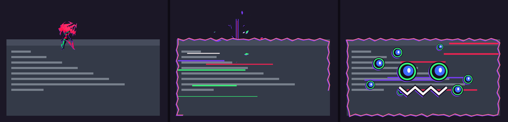

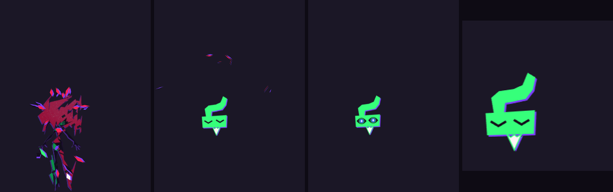

Слежение за окнами пока только для Windows (маленький помощник на PowerShell читает положения окон, без названий и без
содержимого). На macOS и Linux она всё равно парит, выглядывает, падает и гуляет.

### Она показывает, как всё устроено (гид)

**«Как это работает?»** в её меню: она спрашивает, что тебе показать, и ведёт туда, показывая пальцем. Голова резко
поворачивается к цели, она сжимается, отклонившись назад, потом бьёт: рука-конструкт выстреливает вдвое длиннее, с пальца
красная молния, прицел хлопается на цель с двумя её глазами по углам, и вставкой врезается крупный план глаз. Потом она
держит цель, пока объясняет: тонкая нить данных тянется от пальца, время от времени она тычет в неё или оглядывается на
тебя. Закончив, нить втягивается в палец, а рука отскакивает.

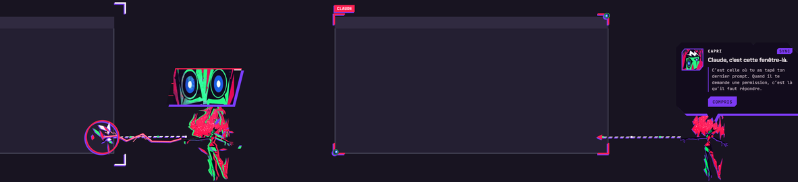

- **«Где моя иконка?»** Она спускается к часам и показывает на свою иконку в трее, или на **^**, когда Windows её прячет.
- **«Где Claude?»** Показывает на окно Claude: то, в котором ты набрал последний запрос.
- **«Папка Claude»:** открывает `~/.claude` в Проводнике с выделенным `settings.json`, показывает на окно и объясняет, что за
  хук там лежит и как его убрать.
- **«Подключить меня к Claude»:** хуки в один клик. То же самое — её приветствие при первом запуске. Рядом **«Бесплатно через
  Ollama»**: запускает Claude Code (или Codex) через Ollama за тебя: хуки встают, Ollama ставится, если её нет, и открывается
  окно с `ollama launch claude`, где ты выберешь модель.
- **«Поговорить со мной»:** см. выше.

Когда она говорит, она строит рожицы: восемь выражений, все — кадры из сериала (наблюдает, отвернулась, клыкастая ухмылка,
глаза навыкате, смотрит прямо на тебя, хохочет с широко открытым ртом, все её глаза сразу, зигзагообразная ухмылка). Каждое
сообщение выбирает подходящее, а портрет глитчит при смене лица.

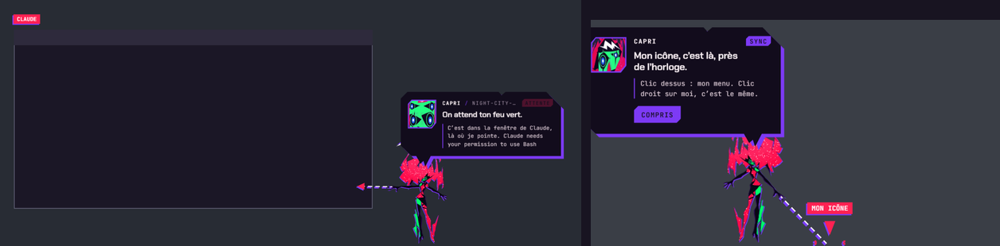


### Отчёт о миссиях

**Отчёт о миссиях** в её меню: карточка с тем, что Claude сделал сегодня, сделанная, чтобы её хотелось заскриншотить.
Крупно — завершённые задачи, затем действия, изменённые файлы и ошибки, самая долгая миссия и её проект, запросы,
подтверждения и проекты. Цифры набегают. Кнопка **«Копировать»** кладёт в буфер обмена изображение карточки на
тёмной подложке, готовое вставлять куда угодно. Вечером (после 18:00), после настоящего рабочего дня (3 задачи и больше),
она сама приносит отчёт один раз. Демо не считается, а статистика остаётся на твоём ПК, по одному дню.

### Сон и ресурсы

Когда она спит (до маски) или спрятана в чип (**Ctrl+Alt+C**), она почти ничего не стоит: рисуется по таймеру и только когда
что-то меняется (несколько кадров в секунду вместо 60–144), помощники на PowerShell, следящие за окнами и музыкой,
останавливаются, она реже проверяет, у компьютера ли ты, звук засыпает через 20 секунд тишины, а слушатель бита ставится на
паузу. В нашем замере работа её окна во сне упала в 4–5 раз, а пробуждения на кадры экрана — в 30–100 раз. Всё, что её зовёт
(клик, Claude, меню, шорткат), включает всё обратно сразу. Бодрствуя, она рисуется «на двойки» (12 рисунков в секунду, как
в аниме) и не будит процессор между ними.

**Обновления тоже экономные:** изменение настройки, которое ничего не меняет, не делает ничего (ни файла, ни сообщения, ни
перестройки меню); частые изменения (ползунок в кольце) пишутся в `config.json` один раз; меню у часов перестраивается не
чаще раза в 0,12 секунды; кусочки ответа идут пачками, а не по одному; список моделей облачного сервиса запоминается на
минуту; регулярные выражения, читающие твои сообщения, «прогреваются», пока она свободна, чтобы первое сообщение не
тормозило на 150 мс. В установщик попадают только шрифты, которые ей нужны (`assets/fonts`), без карт и описаний типов из SDK.

### Языки

Она говорит на **русском и английском** и сама выбирает язык твоей системы (русский, если система русская, иначе
английский). Другой можно выбрать в меню (вкладка **Ещё** › язык, или меню у часов › **Язык**). Французский, испанский и
португальский убраны: меньше строк и проверок, а настройка `lang` из старого файла с этими языками читается как `auto`.

### Звуки

Все звуки синтезируются на лету (Web Audio): в репозитории нет ничего, на что распространяются чужие права. Можно положить
свои файлы в папку своих звуков (меню у часов › **Звук** › **Открыть папку своих звуков**), назвав их так (`.mp3`, `.wav`,
`.ogg` или `.m4a`):

| Файл | Когда |
|---|---|
| `teleport-out` | она исчезает |
| `teleport-in` | она появляется |
| `done` | Claude закончил |
| `alert` | Claude ждёт твоего разрешения |
| `error` | команда упала |
| `hello` | началась сессия |
| `star` | она смотрит на спутник |
| `land` | она приземляется после падения |
| `rise` | рывок в победную позу, красный свет уходит вверх |
| `bolt` | её красная молния |
| `charge` | зарядка перед красным светом |
| `possess` | смеётся окно, которое она захватила |
| `blip` | каждый слог, пока она говорит |
| `tick` | тихое напоминание |
| `growl`, `rage`, `huff` | рычит, ярость, фыркает |
| `giggle`, `laugh` | хихикает, хохочет |
| `sigh`, `sting`, `shy` | вздох, обида, смущение |
| `startle`, `dizzy`, `yawn` | вздрагивает, кружится голова, зевает |
| `skip` | переключает трек (режим DJ) |
| `win`, `lose` | выиграла или проиграла в аркаду |

---

## Демо без Claude

```bash
npm run demo
```

Проигрывает фальшивую сессию от начала до конца (чтения, запрос в сеть, субагент, записи, упавший тест, запрос разрешения,
конец), а потом показывает всё, что она делает сама, с подписью перед каждым фокусом: другие разумы, удар по курсору, весь
спутник, вселение в окно (для неё открывается маленький терминал, потом закрывается под ней, и она падает), сон до маски и
уход в левый нижний угол. Запустить можно и из меню у часов (**Запустить демо**, на её языке). Из командной строки демо
по-английски; по-русски: `npm run demo -- ru`.

---

## Это безопасно

- Весь код лежит здесь. Установщик собирается из него командой `npm run dist`: можешь собрать свой.
- С Claude Code она общается только через хук на `127.0.0.1`.
- Что она меняет в системе: хук в `~/.claude/settings.json` (перед этим создаётся копия, и убрать его можно из её меню) и
  запись автозапуска — только если ты поставил галочку. Удаляется как любое приложение: Параметры Windows › Приложения.
- Предупреждение SmartScreen — из-за неподписанного установщика, а не из-за того, что он делает.
- Всё, что она делает руками или глазами, выключено, пока ты не включишь, и включённое всегда видно значком.
- Подтверждение нужно для всего, что нельзя отменить: отправка сообщения, закрытие приложения, переход на сайт, который
  назвала нейросеть, запуск приложения по её тегу. Каждое удаление в главном меню тоже просит второе нажатие, а «Удалить всё»
  и «Удалить Капри целиком» сначала пишут, что именно уйдёт и сколько места освободится.
- **Удаляет она только своё:** то, что лежит в её папке данных, и то, что записала в `installed.json` (модели, которые
  скачала сама, Ollama и Python, которых не было). Папки, которые положил ты, Ollama и модели, поставленные тобой, она
  показывает, но не трогает (модель Ollama можно убрать по одной, если нажал сам). Всё, что она стирает в своей папке,
  проверяется: путь должен лежать внутри неё.
- **Окна двигает осторожно:** только положение (не размер, не порядок и не то, какое окно активно), только обычные окна,
  не развёрнутые на весь экран, по одному за раз и в пределах экрана; в конце окно возвращается на место (даже если она
  вдруг замолчит или закроется), а если ты сам взялся за окно, она сразу отпускает и не тянет его обратно. Не двигает окна
  программ, запущенных от администратора. Выключается галочкой «Двигать окна, в которые вселилась».

---

## Что уходит с твоего компьютера

**Хуки Claude Code.** Хук хранит только то, что нужно для показа (название инструмента, путь к файлу, команда, начало
твоего запроса, последнее сообщение Claude до 6000 символов — чтобы она могла показать его тебе; всё обрезано) и отправляет
это только на `127.0.0.1`. Содержимое твоих файлов не отправляется: при записи уходит только размер.

**Её чат.** Уходит к тому, кого ты выбрал ей в «мозги». Каждое твоё сообщение она сопровождает подсказкой, которую
собирает заново, и нейросеть получает: кто она и как говорить; твоё имя, твоё «как быть» и что просил запомнить; уровень
связи, стиль, который она подметила, и записи блокнота; её настроение и его причину; что она сейчас делает, что играет у
тебя (исполнитель и название) и который час; описание того, что она видела на экране (только если включено зрение); что
делает Claude и сегодняшние итоги; список её возможностей и открытых приложений; последние 20 сообщений чата. Никаких
движений и анимаций туда не отправляется, а метка настроения `[[mood: …]]` в ответе управляет лицом и телом, метки
действий — открытием приложений, музыкой и сайтами (часть за кнопкой подтверждения). Ollama на твоём ПК
(`127.0.0.1:11434`) всё это оставляет у тебя; Claude или другой облачный сервис получает эти сообщения. Каждые несколько
сообщений она ещё отправляет им последние реплики с просьбой обновить блокнот. Отключается во вкладке **Характер**
(эмоции, «знать, что играет», «узнаёт меня»); зрение и микрофон по умолчанию выключены.

**API-ключи** хранятся зашифрованными (твоей учётной записью Windows) и отправляются только в тот сервис, которому принадлежат.

**Осмотр компьютера и загрузки.** Чтобы подобрать нейросети, она один раз смотрит на железо (процессор, память, видеокарты,
свободное место): всё это остаётся у тебя, в `config.json`, и никуда не уходит. Когда чего-то не хватает, она скачивает: Ollama
(`github.com/ollama` или `ollama.com`) и модели (`registry.ollama.ai`), программу Piper (`github.com/rhasspy`), голоса Piper и
модель Chatterbox (`huggingface.co`, или твоё зеркало `hfEndpoint`), пакеты Python (`pypi.org`) и torch для видеокарты
(`download.pytorch.org`), портативный Node.js (`nodejs.org`: список версий, zip и его контрольная сумма) и, если нет
`winget`, установщик Ollama или Python. Скачивает она, ничего о тебе при этом не отправляя. Когда всё положено заранее (см.
[«Что положить в папку с Капри»](#что-положить-в-папку-с-капри)), в сеть она не ходит.

**Проверка «есть ли у неё нейросеть».** Чтобы знать, нужно ли напомнить тебе подключить её, она изредка спрашивает у выбранного
«мозга» список его моделей (у Ollama на твоём ПК это локальный запрос; у облачного сервиса это тот же запрос списка моделей, что и в
меню **ИИ**, раз в 15 минут, пока он подключён, и раз в полторы минуты, пока нет). Текста, сообщений и ничего о тебе в нём нет.

**Настройка модели и образец голоса.** Проверка скорости идёт только к локальной Ollama (`127.0.0.1`) и ничего никуда не
отправляет, результат (токены в секунду, доля на видеокарте) лежит в `config.json`. Запись, которую ты дала как образец голоса,
копируется в `voices/` её папки данных и читается только Chatterbox на этом ПК; облачным голосам и сервисам она не уходит.

**Удаление.** Всё, что она убирает, она убирает у тебя на диске: списки, размеры и удаление моделей идут через Ollama на
твоём ПК (`127.0.0.1`), никуда ничего не отправляется.

**Голос.** Если ты выбрал для неё облачный сервис (OpenAI, ElevenLabs), текст озвучки уходит туда и никуда больше
(системный голос, Chatterbox, Piper и сервер на твоём ПК оставляют его у тебя). Что играет (исполнитель и название), читается на твоём ПК и
попадает только в подсказку её чата, чтобы она могла об этом говорить.

**Чувства**, когда ты их включаешь: снимок экрана уходит только в выбранную модель зрения (локальная оставляет его у тебя)
и нигде не сохраняется; твой голос уходит только в выбранный сервис распознавания (сервер на твоём ПК оставляет его у тебя),
запись не хранится; звук системы, под который она танцует, обрабатывается локально (громкость и ритм) и не записывается и
не отправляется. Вкладки **Микрофон** и «Слышать свой микрофон» держат микрофон открытым, только пока открыты, и значок это
показывает. Её руки работают целиком на твоём ПК и никуда ничего не отправляют.

**Что она о тебе узнала** (твой стиль, что тебе нравится в её ответах, блокнот) остаётся в `bond.json` на твоём ПК. Блокнот
пишет та же нейросеть, с которой ты с ней общаешься (локальная оставляет всё у тебя). Её настроение, обиды, занятия и
журнал миссий тоже остаются в её папке данных.

---

## Если что-то не работает

- **Фон у неё чёрный (не прозрачный).** У некоторых ПК её прозрачное окно показывается чёрным (часто видеокарты NVIDIA с
  включёнными FXAA, MFAA или HDR; другие программы-оверлеи там делают то же). Правый клик по ней или по её иконке у часов ›
  **Отображение** › **OpenGL (если её фон чёрный)**: она перезапустится и будет рисоваться по-другому. Всё ещё чёрный —
  **Без видеокарты (если всё ещё чёрный)**: процессору придётся чуть больше работать. Помогает и отключение FXAA и MFAA в
  панели управления NVIDIA.
- **Она почти не двигается, вступление просто появляется и исчезает.** В Windows отключены анимации (Параметры › Специальные
  возможности › Визуальные эффекты › Эффекты анимации), и она следует этому. Меню › **Анимации** › **Все** заставит её двигаться
  всё равно; в первый раз она сама спросит.
- **Она молчит или «нет связи».** Вкладка **ИИ › Проверить связь** покажет причину; таблица ошибок —
  [выше](#проверка-связи-и-ошибки).
- **Она только парит и говорит пустяки, а на Claude не реагирует.** Это нормально, пока Claude Code ничего не делает. Если
  не реагирует совсем: проверь, что в её меню написано «Хуки Claude Code: установлены», затем полностью закрой Claude Code и
  открой снова.
- **Нет звука голоса.** Вкладка **Голос**: не стоит ли «Молчит» или «Без звука» и верное ли устройство; кнопка «Проверить звук».
- **Chatterbox не запускается или молчит.** Меню у часов › **«Подготовка (Ollama и Chatterbox)…»**: у шага, который не вышел,
  написана причина; **«Скопировать отчёт»** покажет всё остальное. Пока он не готов, она говорит системным голосом.
- **Ollama «не отвечает».** То же окно подготовки. Если Ollama уже стоит у тебя и работает в трее, Капри берёт её как есть и
  не запускает вторую.
- **Микрофон не открывается.** Windows › Параметры › Конфиденциальность › Микрофон: разреши классическим приложениям;
  вкладка **Микрофон** › «Ещё раз».
- **Она не сидит на окнах, не знает музыку, не управляет окнами.** Эти функции только для Windows.
- **Где она?** Если ты её спрятал, **Ctrl+Alt+C** или меню у часов › **Вернуть её**.
- **В главном меню не видно моделей Ollama.** Ollama сейчас не отвечает: запусти её (или нажми «Установить и запустить» выше) и
  открой раздел «Что стоит на компьютере» ещё раз.
- **Удаление пишет «файл занят».** Программа, которую она убирает, ещё работает или антивирус держит файл. Закрой её и нажми
  «Удалить» ещё раз: что получилось удалить, уже удалено, а остальное она сделает со второго раза.
- **Она говорит, что ей нечем думать, а я не хочу ничего подключать.** Выбери в главном меню «Пока никак» (или закрой его,
  ничего не выбрав): напоминания остаются редкими (не больше пяти за запуск), а нейросеть можно подключить в любой момент.
- **Она двигает моё окно, а мне не надо.** Меню у часов (или кольцо › **Характер**) › сними **«Двигать окна, в которые
  вселилась»**; снятая галочка **«Вселяться в мои окна»** отключает вселение совсем.
- **Убрала модель, а она снова качается.** Не должна: после удаления последней модели `autoMind` выключается, а убранный
  голос становится системным. Если выбрать Ollama или голос заново в главном меню, подготовка включится обратно.
- **Начать с нуля.** Сначала открой главное меню › «Что стоит на компьютере» › **«Удалить всё, что поставила я»** (иначе
  скачанное останется на диске), затем закрой Капри и удали папку данных (`%APPDATA%\Capri`, а из исходников
  `%APPDATA%\capri-desktop`). Проще всего удалить Капри и ответить «Да» на вопрос про скачанное.

---

## Вопросы и ответы

- **Mac, Linux?** Готового установщика нет, но можно запустить из исходников (см. [выше](#вариант-2-из-исходников-windows-macos-linux)).
  Окна, музыка и руки работают только в Windows.
- **Телефон, Android?** Нет, ей нужен рабочий стол.
- **Какие ИИ-помощники для кода она понимает?** Claude Code, Codex и Antigravity: меню › **Что отслеживать**. Cursor, Windsurf
  и Gemini CLI пока нет.
- **Нужен ли мне платный Claude?** Нет. Для чата подойдёт бесплатный Ollama или Groq; платный Claude нужен только если хочешь
  Claude как «мозг» или следить за Claude Code.
- **Ollama?** Двумя способами. Claude Code на локальной модели через Ollama (`ollama launch claude`): она видит его как обычный
  Claude Code, только он медленнее, и бегущая строка считает секунды. И она сама может болтать с тобой через Ollama: см.
  [Как подключить нейросеть](#как-подключить-нейросеть).
- **Как поменять нейросеть или голос потом?** Правый клик по Капри › вкладка **«Ещё»** › **«Главное меню (нейросети)…»**.
- **Как перенести Капри в другую папку?** Главное меню › шаг «3. Установка» › «Куда всё скачивается» › «Выбрать место…», а потом
  «Перенести уже скачанное сюда» (подробнее в разделе [Куда она всё скачивает](#куда-она-всё-скачивает)). Сама программа (то,
  что ставит установщик) переезжает только переустановкой: удали Капри в «Приложениях» и поставь заново, а скачанное можно
  оставить: выбери ту же папку `Capri`, и она найдёт всё на месте.
- **Как скачивать не на диск C:?** Главное меню › шаг «3. Установка» › «Куда всё скачивается» › «Выбрать место…». Она создаст там
  папку `Capri` и дальше будет класть всё в неё (подробнее в разделе [Куда она всё скачивает](#куда-она-всё-скачивает)).
- **Кнопка «Остановить» не останавливает?** Теперь останавливает сразу: завершает pip и установщики вместе с тем, что они
  запустили, и закрывает скачивание. Если что-то из этого всё-таки осталось в диспетчере задач, пришли отчёт («Скопировать отчёт»).
- **Как освободить место на диске?** То же меню › **«Что стоит на компьютере…»**: видно, сколько что занимает, и можно
  удалить ненужную модель, голос или всё сразу. Если удалять саму Капри, установщик спросит, убрать ли скачанное заодно.
- **Она трогает мои модели Ollama и мои папки?** Нет. Своё (то, что скачала сама и записала) она удаляет целиком, а твоё
  показывает и не трогает; одну модель Ollama можно убрать, если ты сам нажал «Удалить».
- **Зачем ей Node.js?** Самой Капри он не нужен (в неё встроен свой). Он нужен для хуков Codex и для запуска из исходников,
  поэтому она проверяет, есть ли он, и при необходимости ставит портативный. Отключается ключом `autoNode` или галочкой в
  главном меню.
- **Она двигает мои окна, это безопасно?** Двигается только положение окна, в конце оно возвращается на место, а если ты
  берёшься за окно сам, она его отпускает. Подробно — [Это безопасно](#это-безопасно). Выключается галочкой.
- **Можно её выключить?** Ctrl+Alt+C прячет, **Выйти** в её меню закрывает. Claude Code без неё работает точно так же.
- **Она тратит много ресурсов?** Нет: во сне и в чипе почти ничего (см. [Сон и ресурсы](#сон-и-ресурсы)).
- **Она читает мою переписку и экран?** Только то, что ты включил: зрение и микрофон выключены по умолчанию, а включённое
  показывается значком. Что именно уходит и куда — в разделе выше.

---

## Как она нарисована

Цель: чтобы она выглядела так, будто шагнула из аниме, а не как виджет.

- **Цельная анимация:** тело перерисовывается 12 раз в секунду («на двойки»), как в аниме, 24 — при телепортах. Каждый
  рисунок слегка «кипит» (дрожание линии, перерисованной вручную).
- **Покадрово, от позы к позе:** ничего не интерполируется. Каждое движение — карта экспозиции (`acting.js`): ключевые
  рисунки, удержанные несколько кадров, замах в обратную сторону, размазанный кадр с несколькими головами, перелёт, паузы.
  Её покой — четыре рисунка, а не синусоида.
- **Она играет головой и гривой,** как в сериале: склонённая голова, осколки то ощетиниваются, то разлетаются, безумный смех
  с трясущейся на каждом рисунке головой, поникшая во сне. Вырезка собрана так, что голова наклоняется вокруг шеи, грива
  раздувается неравномерно вокруг жёсткого лица, а бёдра складываются (в ракурсе спереди), и она сидит с качающимися голенями.
- **Сжатие и растяжение, остаточные образы:** плоская вырезка сплющивается до полоски, чтобы развернуться, вытягивается при
  падении, расплющивается при приземлении и распадается на зелёную и красную копии («другие разумы» в ней), когда она
  крутится или смеётся.
- **Спутник,** как в финале сезона, где она показывает на огонёк в небе и думает, смогут ли они долететь туда: точка света
  медленно пересекает верх экрана. Чаще она просто смотрит, тянется, он мигает, она вздыхает. Раз в день и после долгой
  работы Claude — вся последовательность из пяти ударов:
  1. **Тишина:** она замирает, белые крапинки гривы поднимаются созвездием над ней.
  2. **Протянутая рука:** рисунки сбиваются в кучу, пока рука дотягивается, а её звёзды выстраиваются дорогой от кончиков
     пальцев к спутнику.
  3. **Замах:** она сжимается, рука чуть отводится назад, искры ползут по ладони, вставка с глазами.
  4. **Красный свет уходит вверх:** тяжёлая сужающаяся молния несётся вверх за три рисунка, первый — в негативе (кадр-удар),
     звёзды вспыхивают по пути, у спутника линии скорости, а её поднимает вместе с ней.
  5. **Ответ:** молния обрывается, обломки падают. Тишина, потом спутник дважды мигает. Её звёзды возвращаются домой, грива на
     миг вспыхивает ярко, а рука опускается со вздохом.
- **Руки удлиняются, когда она целится:** аниме-преувеличение, иначе поднятая рука потерялась бы в гриве. Растягивается только
  вдоль, остаётся такой же тонкой и не гнётся вместе с головой и гривой.
- **Обе руки одинаковые:** в исходной вырезке одна рука тянулась, а другая висела. Висящая убрана (`tools/build-sprite.py`), а
  шейдер рисует вместо неё зеркальную протянутую, так что обе кисти — те же когти и обе руки могут играть. Там, где рука
  пересекает тело или гриву, на ней появляется фиолетовая линия, чтобы читалась.
- **Её текстура:** красная грива доведена до горячего красного цвета сериала и усыпана мерцающими белыми крапинками. От неё
  отрываются и уплывают осколки.
- **Фиолетовый сдвиг:** как в аниме, смещённая фиолетовая копия под ней, под панелью, под осколками.
- **«Реликтовый» глитч:** сдвинутые горизонтальные полосы и разделение RGB в духе появлений Джонни Сильверхенда.
- **Телепорт:** зарядка, осколки, схлопывание в линию, а на её месте — чёрная щель с красной линией, как в сериале. Красный
  столб света в небо, молния к цели, её куски (осколки гривы и зелёные звёзды глаз) спиралью возвращаются, и два *кадра-удара*.
- **Вступление:** крупный план, вырезанный так, что рабочий стол виден вокруг гривы (`tools/build-intro.py`), шесть
  рисунков, сменяющихся как целлы (в покое, рот приоткрыт, наполовину и широко для «привет», рука наклонена в одну и другую
  сторону для взмаха, на тройки), а всё остальное — анимация поверх: кадры-удары (она как плоская белая, потом чёрная
  силуэтная), RGB-расщепление, которое успокаивается, тряска экрана, линия, кипящая на двойки, её глаза, перерисованные
  поверх картинки, чтобы могли оглядываться и моргать, наезжающая камера, хлопающий тег. Прямого края картинки никогда нет
  на экране: она видна сквозь рваные движущиеся вырезы.
- **Вставки:** крупные планы из сериала с линиями скорости: ухмылка или смех после законченной работы, все глаза, когда
  Claude ждёт тебя, глаза перед красным светом, взгляд искоса после удара по курсору. Лицо в панели тоже меняется от того,
  что она говорит.
- **Маска:** векторный рисунок по сериалу («Capri Wink Face»), на своём маленьком холсте, перерисовывается, только пока на
  экране: зелёная плита лица, загнутый шип, белый клык, голубые миндалевидные глаза и закрытые шевронами глаза, когда она спит.
- **Шрифты:** Chakra Petch (скошенные срезы, как у её осколков) и JetBrains Mono для данных.

Если в Windows отключены анимации, она обходится плавными появлениями и исчезновениями.

---

## Для разработчиков

```
hooks/capri-hook.js      запускается Claude Code, читает событие со stdin и отправляет в приложение
hooks/capri-codex-hook.js, hooks/capri-agy-hook.js   то же для Codex и Antigravity
scripts/install-hooks.js добавляет и убирает хук в ~/.claude/settings.json (так же *-codex-*, *-agy-*)
scripts/demo.js          проигрывает демо-сессию через тот же HTTP-мост
scripts/check-llm.js     самопроверка: бесплатный шлюз и Claude Code через llm.js
scripts/install-node.ps1 для start-capri.cmd: ищет Node.js и ставит портативный, если его нет (nodejs.org, контрольная сумма, PATH)
start-capri.cmd          запуск из исходников одним щелчком (Windows): Node.js, `npm install`, `npm start`
build/installer.nsh      добавка к деинсталлятору NSIS: спрашивает, убрать ли скачанное (`Capri.exe --remove-everything`)
tools/build-sprite.py    пересобирает спрайт из исходной вырезки (Python + Pillow, только если меняешь)
tools/build-cutins.py    вырезает вставки и её лица из кадров сериала
tools/build-intro.py     вырезает крупные планы вступления из фона
src/main/                Electron: полноэкранное прозрачное окно, сквозное для кликов, трей, локальный HTTP-мост
  main.js                окно, трей и его меню, все IPC-каналы
  anthropic.js           Claude через официальный SDK @anthropic-ai/sdk: поток ответа, модели, зрение, повтор при отказе
  llm.js                 все «мозги»: Ollama, Claude, Claude Code, OpenAI-совместимые серверы
  setup.js               мастер подключения: Ollama через winget, шифрование ключей
  config.js              настройки: пустые изменения пропускаются, одна атомарная запись на пачку
  windows.js / .ps1      где другие окна (только Windows), чтобы она сидела на них
  mover.js / .ps1        двигает окно, в которое она вселилась (только Windows): одно окно, только положение, возврат на место, отпускает, если ты взялся за окно
  media.js / .ps1        что играет, из медиа-управления Windows
  ollama.js              её чат: локальная модель через Ollama
  apps.js                закрытие приложения, которое ты просил закрыть (после твоего клика)
  launch.js              запуск приложений, игр, музыки, сайтов
  control.js             её руки: окна, сообщения, мышка, кнопки по имени (UI Automation) и клавиши через PowerShell, только в нужное окно
  web.js                 адреса поиска, первое видео YouTube, открытие https-адресов её сайтов
  screen.js              снимок экрана (desktopCapturer); llm.js see() запускает модель зрения
  tts.js / stt.js        голосовые сервисы (Chatterbox, OpenAI, ElevenLabs, свой сервер) и распознавание речи
  chatterbox.js          её голос: находит папку Chatterbox и её Python, запускает маленький сервер вокруг него, следит за ним
  chatterbox-server.py   сервер вокруг библиотеки Chatterbox (OpenAI-совместимый /v1/audio/speech, куски текста, «паузы»)
  chatterbox-setup.js    Python, venv, pip для Chatterbox, сборка torch для видеокарты
  ollama-host.js         её разум: находит Ollama в папке рядом, запускает `ollama serve` с её моделями, останавливает
  hub.js, hub-lines.js   её главное меню (окно первого запуска и вкладки «Ещё»): выбор нейросетей, подключение сервисов, установка, «Что стоит на компьютере» и удаление; его тексты
  stacking.js            когда поднять её окно над панелью задач (windows.ps1 говорит, что панель над ней)
  hardware.js            осмотр ПК: система и разрядность, процессор, память, видеокарты (PowerShell, nvidia-smi), диск
  profiles.js            профили (облачный, лёгкий, средний, мощный): модель, голос, устройство, объём загрузки, настройки
  tune.js                как она просит модель в каждой задаче (чат, заметки, взгляд на экран), память разговора, разбор проверки скорости (чистые функции)
  voice-sample.js        запись, которую ей дали как голос: проверка WAV, копия в её папку, замена и удаление, комплектная запись
  piper.js               лёгкий голос Piper: поиск программы и голосов, скачивание, одна запущенная программа на все реплики
  fetch-files.js         скачивание с полосой прогресса и контрольной суммой, распаковка zip (на чистом Node) и tar.gz; всё это можно остановить
  downloads.js           папка «Capri» для всего скачанного: выбор места, пометка, проверка, временные файлы
  relocate.js            перенос уже скачанного в выбранную папку (rename или копия с проверкой, откат, остановка) и поиск вручную перенесённого
  proc.js                запуск программ и их остановка вместе с тем, что они запустили (кнопка «Остановить»)
  provision.js           подготовка при запуске: осмотр, профиль, шаги Node.js, Ollama, Chatterbox и Piper, прогресс, отчёт
  node-check.js          Node.js: поиск, портативная установка с nodejs.org (контрольная сумма), запись в PATH и её удаление
  installed.js           `installed.json`: что она сама поставила (модели, Ollama, Python, Node.js), чтобы убрать только это
  cleanup.js             что стоит на ПК из-за неё и сколько занимает; удаление по одному и всё сразу; настройки после удаления
  prepare.js             окно подготовки (renderer/prepare.html) и его каналы; prepare-lines.js: его тексты (ru, en)
  proc.js                общее для запускаемых программ: убить с детьми, найти в PATH, папки рядом
src/renderer/js/
  sprite.js              шейдер WebGL: наклон головы, раздув гривы, сидение, размазывание, остаточные образы, цвета, глитч
  acting.js              карты экспозиции: каждое движение, рисунок за рисунком (и мелкие занятия: болтать ногами, махнуть рукой, поправить гриву)
  capri.js               сам персонаж: стойки, телепорт, сидение, выглядывание, падение, перетаскивание, сон
  fx.js, fx-life.js      осколки, столбы света, молнии, глифы, линии скорости, ударные волны, спутник, вселение, вставки, вступление; следы настроений и реквизит занятий
  panel.js               панель «передачи», её лица, бегущая строка
  guide.js               её гид: уроки, перемещение к предметам и показ на них
  brain.js               превращает события Claude в реплики и действия
  mission.js             журнал миссий за день для отчёта
  chat.js                разговор с ней: диалог, кто она, приходящие ответы, команды «открой/закрой/напиши»
  lines.js, lines-life.js   что она говорит (RU / EN)
  chip.js                её маска: во сне и внизу слева, когда её спрятали
  voice.js               звуки и выбор устройства вывода
  mood.js, heart.js      чувства: что значит сообщение, сколько держится, обиды; связь чувств с телом, лицом, цветом, голосом; реакции на мышку и напоминание «подключи нейросеть»
  life.js                что она делает сама, музыка, DJ, замечает тебя
  themes.js              её цвета
  speech.js              голос: системный или из Chatterbox и облачных сервисов через эффект «множества разумов»
  eyes.js, rhythm.js, hands.js, ears.js   зрение, танец, руки, слух
  bond.js                саморазвитие: стиль общения, реакции, блокнот, уровень близости
  ring.js, ring-tabs.js, ring-ui.js   круговое меню: кольцо, вкладки, переключатели и ползунки (styles/ring.css)
  ledges.js              где она может сидеть и куда приземляется: её место на окне, падение, посадка (чистые функции)
  possession.js          как она двигает окно, в которое вселилась: траектории тряски, качки, танца, прогулки, шайбы и прыжков (чистые функции)
  pointer-life.js        читает мышь: затрясли ли курсор из стороны в сторону
  steps-view.js          как рисуются шаги подготовки и общая полоса голоса (общее для окна подготовки и главного меню)
  tongue.js              на каком языке написан текст (по словам): на нём она отвечает и читает ответ
  persona.js             её первый промт (русский и английский) и то, что снимается с ответа: «Конечно!» в начале, шаблонный вопрос в конце
  listen.js              слух: детектор начала и конца фразы по отсчётам, шум комнаты, запас перед началом, WAV 16 кГц
  pcm-worklet.js         аудио-воркклет: отсчёты микрофона по десятой доле секунды
  web.js                 просьбы к браузеру (поиск, видео) из твоих слов и из тега
  hands-parse.js         просьбы к мышке, клавишам и кнопкам окон; имена окон по-русски
  brain-providers.js     кто может отвечать: группы и какие берут ключ (вкладка ИИ)
assets/fonts             нужные шрифты (лицензии рядом)
```

**Тесты:** `npm test` запускает всё; по отдельности `test:character`, `test:senses`, `test:bond`, `test:ring`, `test:claude`,
`test:claudecode`, `test:chat`, `test:config`, `test:chatterbox`, `test:ollama`, `test:provision`, `test:prepare`, `test:hardware`, `test:profiles`, `test:tune`, `test:voice-sample`, `test:voice-demo`, `test:piper`, `test:hub`, `test:labels`, `test:openai`, `test:release`, `test:cleanup`, `test:node`, `test:heart`, `test:possession`, `test:mover`, `test:acting`, `test:ledges`, `test:stacking`, `test:hooks`. Подключение к Claude проверяется на заглушке API Anthropic
с настоящим SDK, так что ни ключ, ни сеть не нужны; чат через Claude Code — на заглушке команды `claude`.

**Проверка в живом приложении.** Кроме `npm test` у проекта нет отдельного набора сценариев, но нужные проверки легко
собрать: Electron под Playwright (`_electron`) с папкой-заглушкой Ollama (`tests/fixtures/fake-ollama.js`) и Piper
(`fake-piper.js`) проходит весь путь «первый запуск › главное меню › установка › ответ › озвучка › удаление».
`Capri.exe --remove-everything` (его запускает деинсталлятор) убирает всё, что она поставила, без окна и выходит.

**Разработка:** `npm run dev` включает отладочные маршруты на мосту: `/debug/capture` сохраняет кадр окна в `captures/`,
`/debug/testwin` открывает тестовые окна, на которые она может сесть (по одному на имя), `/debug/mouse` двигает и кликает
подставным указателем над её окном, не трогая настоящий, `/debug/type` печатает в её чат, `/debug/command` посылает ей
команды: например `POST http://127.0.0.1:47823/debug/command` с телом `{"name":"feel","text":"ты дура"}`, `{"name":"ring","tab":"brain"}`,
`{"name":"lookNow"}`, `{"name":"pushToTalk"}`.

`npm run dist` собирает 64-битный установщик для Windows в `dist/`, `npm run dist:32` — 32-битный.

**Выпуск релиза.** Установщики в обычный git класть нельзя (x64 больше лимита GitHub в 100 МБ на файл), их место — в
**Releases**. Это делает GitHub Actions (`.github/workflows/release.yml`) по кнопке, ничего собирать у себя не нужно:

1. Поменяй версию в `package.json`, а в `.github/RELEASE_NEWS.md` напиши, что нового (этот текст попадёт в описание релиза).
   Закоммить и отправь в `main`.
2. На странице репозитория: **Actions › Release › Run workflow** (при желании укажи свой тег и отметь «пре-релиз»).
3. Подожди 10–20 минут. Сначала прогоняются тесты, потом на Windows собираются оба установщика (x64 и ia32), и в конце
   публикуется релиз `v<версия>` с обоими `.exe`, описанием на русском и контрольными суммами SHA-256.

Если такой тег уже есть, процесс остановится и скажет об этом: удали старый релиз и тег или укажи другой. Actions должны
быть включены в настройках репозитория (**Settings › Actions › General**). Права на запись для публикации релиза процесс
запрашивает у GitHub сам (в файле указано `contents: write`), менять для этого настройки не нужно. Установщики не подписаны, как и при локальной сборке.

---

## Авторы и права

Проект основан на [capri-desktop](https://github.com/mochiiwuff/capri-desktop) (автор — mochiiwuff) и развит дальше:
круговое меню, подключение нейросетей, чувства, руки, саморазвитие.

Права на Капри / Project Capricorn, Cyberpunk и Cyberpunk: Edgerunners принадлежат CD PROJEKT RED, Studio Trigger и Netflix.
Это некоммерческий фанатский проект, не связанный с ними. Изображения персонажа в `assets/capri/` взяты из кадров сериала,
вырезки, сделанной фанатами, и фанатского арта (крупные планы вступления); на них **не** распространяется MIT-лицензия кода.
Если правообладатель захочет их убрать, открой issue.

Шрифты: Chakra Petch и JetBrains Mono по лицензии SIL Open Font License, через Fontsource.

Код — MIT.
